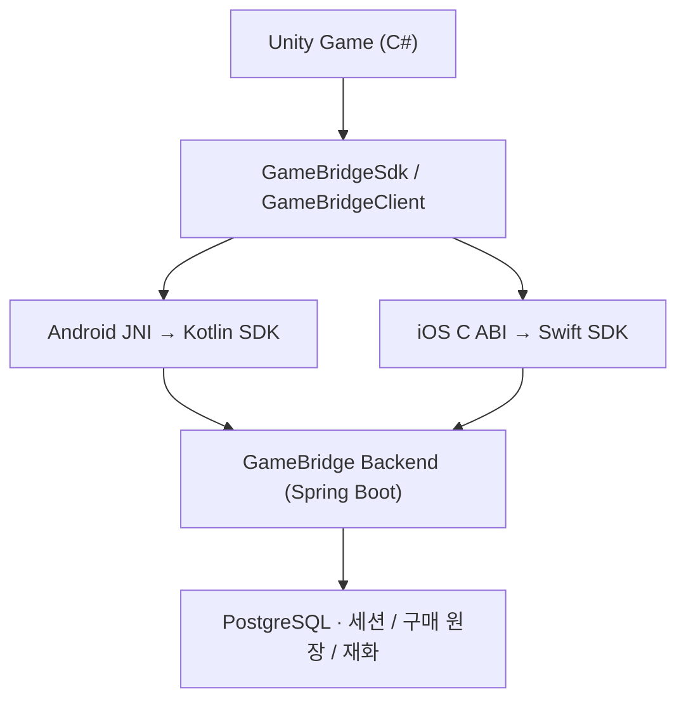

# GameBridge SDK


**Unity 게임에서 Android·iOS 네이티브 기능과 게임 Backend를 하나의 C# 인터페이스로 연결하는 SDK 프로젝트입니다.**

**Android Google 로그인과 iOS Apple 로그인**, **Google Play Billing / Apple StoreKit**, **FCM / APNs**를 연결하는 코드를 포함하며, 게임 계정·구매·재화·푸시를 Unity C# API로 다룹니다. Unity C# SDK, Kotlin/Swift 네이티브 브리지, Spring Boot·PostgreSQL Backend로 구성되어 있습니다. 기능 구현과 실제 플랫폼에서의 검증은 구분합니다.

> [!IMPORTANT]
> **현재 버전은 `0.1.0-dev` (개발 중)이며 배포 가능한 상용 SDK가 아닙니다.** 일부 Native·LOCAL_MOCK·Fake 경로만 검증했습니다. Unity Editor import/Player/IL2CPP 전체 통합, 실제 Google·Apple 계정/스토어 결제, FCM/APNs 원격 전달은 검증 완료 상태가 아닙니다. 아래 Quick Start 역시 **Editor용 가상 데이터 예제**이며 실제 구매를 수행하지 않습니다.

**바로가기:** [주요 기능](#주요-기능) · [기능별 사용 안내](#기능별-사용-안내) · [Quick Start](#quick-start--unity-editor-offline) · [API](docs/API.md) · [통합 가이드](docs/INTEGRATION.md) · [검증 현황](#검증-현황과-제한사항)

## 주요 기능

| 기능 | Unity에서 사용하는 기능 | 구현·검증 범위 |
| --- | --- | --- |
| **Authentication** | Android Google / iOS Apple 로그인, Mock 로그인, 세션 복원·로그아웃 | Native 연동 코드 및 Fake·LOCAL_MOCK 일부 확인. 실제 계정 로그인 미검증 |
| **In-App Purchase** | Android Google Play Billing / iOS Apple StoreKit, 상품·구매·복원 | Mock DB 지급·중복 방지, iOS Xcode 로컬 일부 확인. 실제 스토어 결제 미검증 |
| **Entitlements** | 코인 잔액·프리미엄 권한 조회, 서버 지급 원장 | LOCAL_MOCK Backend·PostgreSQL 일부 검증 |
| **Push Notifications** | Android FCM / iOS APNs, 알림 권한·등록·해제·수신·열기 | Native Mock·가상 수신 일부 확인. 원격 전달 및 Unity Player 미검증 |
| **Configuration & Diagnostics** | 서비스 점검 설정·캐시, SDK 상태·지원 기능·진단 | Fake·Native 경계 검사. Unity Player 미검증 |

`LOCAL_MOCK`의 구매·잔액은 개발용 로컬 Backend에서 처리합니다. **Google/Apple Store 결제 또는 서버의 실제 스토어 서명 검증 성공을 의미하지 않습니다.** 기능별 세부 상태는 [기능 매트릭스](docs/FEATURE_MATRIX.md)에서 구분합니다.

## 기능별 사용 안내

아래 내용은 [`GameBridgeClient` 공개 API](unity/Packages/com.gamebridge.sdk/Runtime/GameBridgeClient.cs)를 기준으로 합니다. **메서드가 존재한다는 것과 Unity Player에서 동작을 검증했다는 것은 다릅니다.** C# 코드는 SDK 초기화와 해당 플랫폼의 Host/Backend 설정이 완료된 뒤 실행할 수 있는 **호출 예시**이며, 실제 계정·결제 실행 결과를 주장하지 않습니다.

### Authentication — 소셜 로그인과 세션

| 제공자 | Android | iOS |
| --- | --- | --- |
| **Google** | Credential Manager Native 연동 코드 / Fake 시험 | **미구현** (추가 개발 후보) |
| **Apple** | **미구현** (웹 기반 인증 방식 검토 가능) | AuthenticationServices Native 연동 코드 / Fake 시험 |
| **Facebook** | **미구현** (추가 개발 후보) | **미구현** (추가 개발 후보) |
| **Mock** | `LocalMock` 개발용 로그인 | `LocalMock` 개발용 로그인 |

Unity Editor의 `EditorOffline`에도 메모리 기반 Mock 로그인이 있습니다. **Google·Apple 실제 계정 로그인과 Unity Player 전체 흐름은 미검증**입니다. 현재 C# `AuthProvider`에는 `MOCK`, `GOOGLE`, `APPLE`만 존재하며, `FACEBOOK`은 없습니다. 따라서 추가 개발 후보는 **현재 지원 기능이 아닙니다.**

```csharp
// PlatformSandbox로 초기화된 sdk, 실제 계정/Host 설정이 있다는 전제
#if UNITY_ANDROID && !UNITY_EDITOR
var user = await sdk.SignInAsync(AuthProvider.GOOGLE);
#elif UNITY_IOS && !UNITY_EDITOR
var user = await sdk.SignInAsync(AuthProvider.APPLE);
#endif

var session = await sdk.RestoreSessionAsync();
await sdk.SignOutAsync();
```

토큰과 세션 증빙은 Native 및 Backend에서 처리하고 Unity로 원본 토큰을 노출하지 않는 구조입니다. Android/iOS 각각의 인증 설정은 [통합 안내](docs/INTEGRATION.md)와 [사용자 설정](docs/USER_SETUP.md)을 따릅니다.

### In-App Purchase — 상품·구매·복원

**Android**는 Play Billing, **iOS**는 StoreKit 연동 코드가 있습니다. 양 플랫폼 모두 상품 조회, 구매 요청, 미완료 거래 복원, 서버 지급 원장 및 재화 조회를 위한 C# API를 제공합니다.

```csharp
// 초기화·로그인 이후의 호출 예시 (실제 스토어 검증 결과 아님)
var products = await sdk.GetProductsAsync();
if (products.Count > 0)
{
    var result = await sdk.PurchaseAsync(products[0].productId);
    // PENDING / VERIFICATION_PENDING은 지급 성공이 아닙니다.
    if (result.fulfillmentStatus == FulfillmentStatus.GRANTED ||
        result.fulfillmentStatus == FulfillmentStatus.ALREADY_GRANTED)
    {
        var wallet = await sdk.GetEntitlementsAsync();
        // wallet.coinBalance / wallet.premiumEnabled를 게임 UI에 반영
    }
}
var recovery = await sdk.SyncPurchasesAsync(SyncReason.USER_RESTORE);
```

구매 상태 변경은 `PurchaseUpdated` 이벤트로도 받을 수 있습니다. **로컬 Mock Backend/DB 구매·멱등 지급·응답 유실 복구는 일부 PASS**, **iOS 18.6 Xcode 로컬 StoreKit 일부 PASS**, **iOS 26.5 Xcode 로컬 StoreKit 상품 조회 FAIL**입니다. **Google Play 실제 테스트 구매, Apple Sandbox 실제 거래, Unity Player 전체 결제는 미검증**입니다. Xcode 로컬 StoreKit은 Apple 서버 검증과 다릅니다.

### Push Notifications — 알림·등록·수신

**Android**는 FCM Host callback을, **iOS**는 APNs 등록 및 Host 알림 callback을 SDK로 전달하는 경로가 구현되어 있습니다. 공통 API는 `RequestPushPermissionAsync()`, `RegisterPushAsync()`, `UnregisterPushAsync()`이며, `PushReceived`/`PushOpened`/`PushTokenChanged` 이벤트를 제공합니다. 허용하는 화면 route는 `home`과 `store`입니다.

```csharp
// Host의 플랫폼별 푸시 설정을 완료한 다음 사용
sdk.PushOpened += update => Debug.Log("Opened route: " + update.Route);
await sdk.RequestPushPermissionAsync();
await sdk.RegisterPushAsync();
```

`LOCAL_MOCK`의 `SIMULATED` 알림은 실제 FCM/APNs 원격 전송이 아닙니다. Unity Player에서의 권한 UI·실제 수신·재시작 경로는 아직 검증하지 않았습니다.

### Service Configuration & Diagnostics

`GetServiceConfigAsync()`는 점검 설정(`maintenanceEnabled`)과 서버 설정·캐시 상태를 조회합니다. `GetStatus()`/`GetCapabilities()`는 SDK 상태와 모드별 기능 지원 여부를 보여주며, `GetDiagnostics()`/`GetNativeDiagnosticsAsync()`는 제한된 요청·Native 진단 정보를 제공합니다. 각 항목의 실제 검증 근거는 [기능 매트릭스](docs/FEATURE_MATRIX.md)와 [진행 원장](docs/PROGRESS.md)에 있습니다.

## 구조 한눈에 보기



게임에서는 C# API를 호출하고, 플랫폼별 기능은 Android/iOS Native 쪽에서 처리합니다. Backend는 개발용 인증 세션과 구매 지급·중복 처리 등을 담당합니다. 실제 인증·결제·푸시 제공자 연동은 플랫폼 설정이 추가로 필요하며 위 그림은 **구성도이지 전체 E2E 통과를 나타내는 그림이 아닙니다.**

## 지원 환경

| 구성 요소 | 현재 개발·확인 기준 | 주의 |
| --- | --- | --- |
| Unity | 패키지 설정: **6000.5** / 관리 코드 컴파일 기준: **6000.5.8f1** | Editor import, 장면 실행, IL2CPP 및 Player 미검증 |
| Android | Kotlin·JNI, API 36 빌드, JDK 21 | Unity Android Player·실제 Google/Play/FCM 미검증 |
| iOS | Swift·C ABI, Xcode 26.6, XCFramework 소비 링크 | Unity iOS Player·실기기 서명·실제 Apple/StoreKit/APNs 미검증 |
| Backend | Spring Boot·JDK 21·PostgreSQL 17 계열 | 로컬/격리 시험 기준, 운영 검증 아님 |

위 버전은 **확인된 개발 조합**이며 최소 지원 버전이나 다른 조합의 호환성 보증이 아닙니다. 자세한 내용은 [호환성](docs/COMPATIBILITY.md)과 [도구 버전](docs/TOOLCHAIN.md)을 확인하세요.

## Quick Start — Unity Editor Offline

**목표:** 외부 계정, 결제 콘솔, Backend 없이 C# SDK의 호출 형태와 가상 로그인·상품 조회를 살펴봅니다.

1. 저장소를 clone하고 Unity **6000.5 계열**로 별도 테스트 프로젝트를 준비합니다.
2. Unity **Window → Package Manager → + → Add package from disk**에서 `unity/Packages/com.gamebridge.sdk/package.json`을 선택합니다. 이 로컬 패키지는 개발 소스이므로 정식 배포 패키지로 간주하면 안 됩니다.
3. Package Manager의 GameBridge SDK **Samples**에서 **Editor Offline Demo**를 Import합니다. UI 샘플에는 `com.unity.ugui`가 필요합니다.
4. 테스트 Scene의 빈 GameObject에 `OfflineDemo` 컴포넌트를 추가하고, 프로젝트 입력 방식에 맞는 EventSystem을 하나 준비합니다.
5. Editor Play로 Home/Store의 가상 로그인·상품 조회·구매 UI를 살펴봅니다.

[Offline Demo 설명·제약](unity/Packages/com.gamebridge.sdk/Samples~/Offline%20Demo/README.md) · [실제 샘플 C# 코드](unity/Packages/com.gamebridge.sdk/Samples~/Offline%20Demo/OfflineDemo.cs)

동일한 흐름을 직접 작성한다면 다음과 같습니다. `GameBridgeSdk.Create`와 생명주기 API는 Unity 메인 스레드에서 호출하세요.

```csharp
using GameBridge;
using GameBridge.Core;
using UnityEngine;

public sealed class GameBridgeQuickStart : MonoBehaviour
{
    private GameBridgeClient sdk;

    private async void Start()
    {
        try
        {
            // Editor 전용: 실제 로그인·구매·Backend 연결 없음
            var config = new GameBridgeConfig(
                "gamebridge-sample", ProviderMode.EditorOffline, null);

            sdk = GameBridgeSdk.Create(config);
            await sdk.InitializeAsync(config);
            await sdk.SignInAsync(AuthProvider.MOCK);

            var products = await sdk.GetProductsAsync();
            Debug.Log("Mock products: " + products.Count);
        }
        catch (SdkException error)
        {
            Debug.LogError("GameBridge: " + error.Code);
        }
    }

    private void OnDestroy()
    {
        sdk?.Dispose();
    }
}
```

> **실행 검증 주의:** 예제는 저장소의 공개 C# API 및 Offline Demo 소스를 토대로 작성했습니다. 원격 저장소에 기록된 검증은 관리 코드 컴파일까지이며, Unity Editor 라이선스 문제로 실제 Import·Play 실행은 **미검증**입니다.

## Android / iOS Native 연동

Editor Offline과 달리 **Native LOCAL_MOCK / PLATFORM_SANDBOX**는 플랫폼별 산출물 및 Host 설정이 필요합니다.

| 단계 | 확인할 곳 |
| --- | --- |
| 1. Android Maven/AAR 또는 iOS XCFramework 생성 | [통합 가이드 — 패키지 소비](docs/INTEGRATION.md#패키지-소비) |
| 2. Unity UPM staging 준비 및 Native Demo | [Native Demo](unity/Packages/com.gamebridge.sdk/Samples~/Native%20Demo/README.md) |
| 3. Backend 및 테스트 계정·결제·푸시 설정 | [사용자 설정](docs/USER_SETUP.md) |
| 4. API와 결과 상태·에러 처리 | [API 가이드](docs/API.md) |

`LOCAL_MOCK`는 개발 서버 키와 테스트용 Backend를 요구합니다. `PLATFORM_SANDBOX`는 실제 플랫폼 개발자 계정과 별도 설정이 필요합니다. **실제 키·토큰은 소스, Unity 에셋, 로그에 넣지 마세요.** 브리지 연결·로컬 배포 산출물을 만드는 작업과 Unity Player에서 통과한 작업은 별개입니다.

## 개발·검증 명령

로컬 개발 환경에서 사용하는 대표 명령입니다. 필요한 환경변수·전용 DB·산출물 경로는 [사용자 설정](docs/USER_SETUP.md)과 [통합 가이드](docs/INTEGRATION.md)를 먼저 확인하세요.

```bash
# 개발용 Backend: 전용 DB 비밀번호 및 인증·암호화 키 필요
bash scripts/run-demo-backend.sh

# Android Mock SDK 산출물 / iOS 개발용 프로젝트 및 빌드
bash scripts/build-android.sh --mock
bash scripts/generate-ios-project.sh
bash scripts/build-ios.sh --simulator

# 로컬 검사 집계 (PASS / FAIL / 미실행 구분)
bash scripts/verify-all.sh --available
```

생성되는 `artifacts/`는 로컬용이며 공개 Release가 아닙니다. Backend 단위 테스트만으로 DB 통합·Unity Player 테스트까지 실행됐다고 해석하면 안 됩니다.

## 검증 현황과 제한사항

- **확인한 범위:** Kotlin/Swift Native Mock·일부 로컬 Backend/DB, 독립 Android 소비 빌드·iOS XCFramework 링크, Unity C# 관리 코드 컴파일 등.
- **미검증:** Unity Editor import·장면 실행·Android/iOS Player·IL2CPP, 실계정 인증, 실제 스토어 거래, 원격 FCM/APNs.
- **기록된 실패:** iOS 26.5 로컬 StoreKit 상품 조회 시험. iOS 18.6의 일부 별도 시험 PASS가 이를 대체하지 않습니다.
- **전체 판정:** 제품 전체 검증 게이트는 통과한 상태가 아닙니다. 자세한 실패·보류·환경 제약은 [진행 원장](docs/PROGRESS.md)과 [최종 보고](docs/FINAL_REPORT.md)에서 확인하세요.

## 문서 안내

| 문서 | 읽는 목적 |
| --- | --- |
| [API](docs/API.md) | Unity 개발자를 위한 메서드·이벤트·오류 설명 |
| [통합 안내](docs/INTEGRATION.md) | Android/iOS Host, Native 패키징, 인증·구매·푸시 통합 |
| [샘플: Offline Demo](unity/Packages/com.gamebridge.sdk/Samples~/Offline%20Demo/README.md) | Backend 없는 Unity Editor Fake 둘러보기 |
| [샘플: Native Demo](unity/Packages/com.gamebridge.sdk/Samples~/Native%20Demo/README.md) | LOCAL_MOCK 및 플랫폼 Sandbox 설정 |
| [호환성](docs/COMPATIBILITY.md) · [기능별 확인](docs/FEATURE_MATRIX.md) | 플랫폼 지원 범위와 미검증 항목 |
| [보안](docs/SECURITY.md) · [사용자 설정](docs/USER_SETUP.md) | 비밀정보·Host 소유권·실연동 준비 |
| [진행 원장](docs/PROGRESS.md) · [작업 기록](docs/WORK_LOG.md) | 개발 내부 진행 및 실제 검증 증거 |
| [변경 이력](docs/CHANGELOG.md) | 개발 버전별 변경 사항 |

본 README는 **처음 방문하는 사람을 위한 안내**입니다. 작업 ID·세부 로그·재현 명령은 링크된 기술 문서에서 유지합니다.
