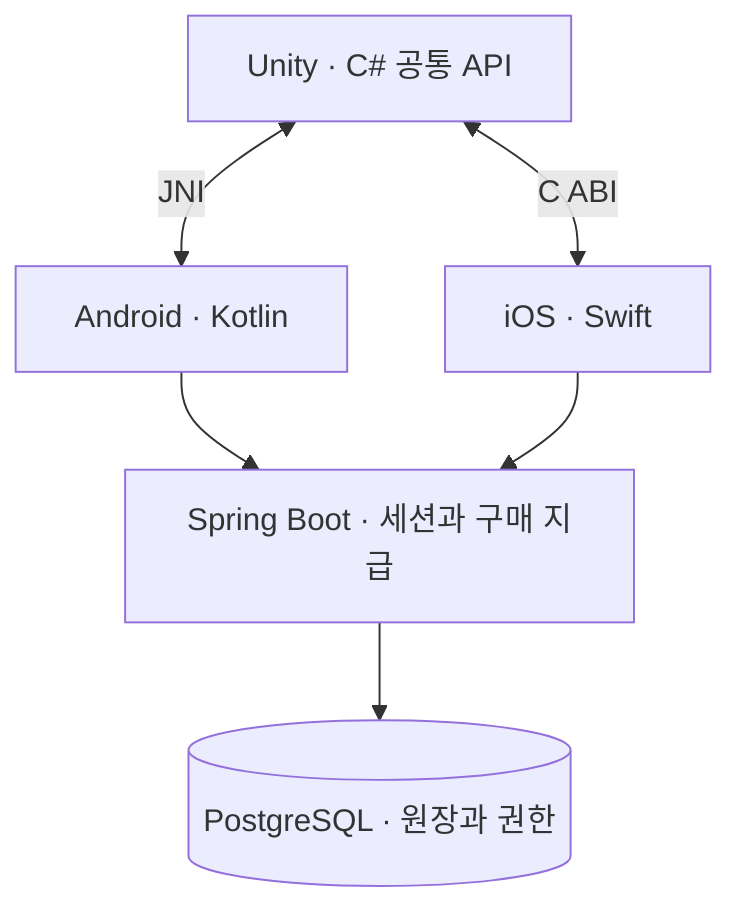

# GameBridge SDK

 

**Unity·Android·iOS의 인증·결제·푸시를 공통 C# API로 연결하는 게임 플랫폼 SDK입니다.**

Kotlin·Swift Native와 Spring Boot·PostgreSQL Backend를 연결하고, **비동기 요청 경쟁, 구매 데이터 정합성, 장애 복구, SDK 소비자 호환성**을 설계·검증했습니다.

개인 기술 포트폴리오 · [v0.1.2-dev Pre-release](https://github.com/CodingBot000/GameBridge_SDK/releases/tag/v0.1.2-dev) · Bridge Protocol v1

**Android 실기기 검증 — v0.1.2-dev:** 삼성 SM-G975N(Android 12/API 31)에서 Native·Unity Google 실계정 인증과 세션 수명주기, SDK 업데이트·구매 복구(LOCAL_MOCK)를 확인했습니다. [실기기 실행 기록](docs/evidence/android-physical-followup-20261127.md)

> **[기술 설계 및 문제 해결](docs/TECHNICAL_OVERVIEW.md)** — 상세 아키텍처 · 설계 선택 · 대표 기술 사례 5개
>
> **[구현과 검증 근거](docs/VERIFICATION_EVIDENCE.md)** — 소스 코드 · 테스트 · 실행 기록 · PR

<a id="대표-설계검증-성과"></a>
<a id="기술적-핵심"></a>

## 핵심 엔지니어링 성과

- **응답 유실 후 구매 복구:** Android 12 실기기의 **LOCAL_MOCK**에서 0.1.1-dev → 0.1.2-dev 덮어 설치 후 세션과 미완료 구매를 복구했습니다. 검증 요청 2회에도 지급 원장 **1건·100코인**, 추가 회수 0건을 확인했습니다. [구매 복구 사례](docs/TECHNICAL_OVERVIEW.md#51-구매-응답-유실과-중복-지급-방어)
- **비동기 요청과 세션 격리:** callback·timeout·cancel의 요청 소유권 제거 경로를 통합해 Task를 최대 한 번 완료하고, 이전 SDK 세션의 지연 응답을 차단합니다. 중복 응답 방어를 제거하는 Mutation Test로 결함 탐지 여부를 확인했습니다. [요청 수명주기](docs/TECHNICAL_OVERVIEW.md#53-비동기-요청-경쟁과-지연-callback)
- **iOS Export 중단 복구:** 파일 해시와 Recovery Journal로 동일 폴더 재시도와 Host 편집 보호를 구현했습니다. **4개 쓰기 지점 장애 주입**으로 복구·충돌 처리를 확인했습니다. [Export 복구 사례](docs/TECHNICAL_OVERVIEW.md#52-unity-ios-export--중단-복구-및-host-변경-보호)
- **SDK 변경 후 소비자 호환성:** C# 공개 메타데이터와 선정 JVM/JNI·C ABI를 비교하고, Maven/R8·Swift/XCFramework·Unity UPM 독립 소비 및 LOCAL_MOCK 버전 교체를 검증했습니다. [리팩토링과 호환성](docs/TECHNICAL_OVERVIEW.md#55-sdk-리팩토링과-소비자-호환성)

## 구조 한눈에 보기



Unity는 요청 수명주기·정제 이벤트, Native는 Provider 연동·Keystore/Keychain 토큰 보관, Backend는 세션 발급·구매 검증·지급을 담당합니다. 인증 토큰과 구매 증빙은 Native·Backend 경계에서 관리하며, 게임 UI에는 서버 지급 결과를 전달합니다.

**[상세 컴포넌트 구조와 요청·구매 시퀀스 보기](docs/TECHNICAL_OVERVIEW.md#2-아키텍처)** · [iOS Framework·OAuth 콜백 문제 해결](docs/TECHNICAL_OVERVIEW.md#54-ios-native-의존성과-oauth-callback-장애-분석)

## 주요 기능

| 구현 영역 | 공통 API / Native 연동 |
| --- | --- |
| 인증·세션 | `SignInAsync`, `RestoreSessionAsync`, `SignOutAsync` · Google·Apple·Facebook Adapter |
| 구매·재화 | `PurchaseAsync`, `SyncPurchasesAsync`, `GetEntitlementsAsync` · Play Billing·StoreKit Adapter, 서버 지급 원장 |
| 푸시 | `RegisterPushAsync`, `UnregisterPushAsync`, `PushReceived`, `PushOpened` · FCM·APNs Host 연동 |
| 설정·진단 | `GetServiceConfigAsync`, `GetStatus`, `GetDiagnostics` · 점검 정책·정제 로그 |

<a id="지원-로그인"></a>

Android 12 실기기의 **0.1.2-dev Native·Unity**에서 Google 실계정 로그인·인증 UI 취소·재실행 후 기존 세션 복원·로그아웃 및 복원 차단을 확인했습니다. [Android 실기기](docs/evidence/android-physical-followup-20261127.md) · [이전 Android AVD](docs/evidence/android-google-live-20261125.md) · [이전 iOS Simulator](docs/IOS_GOOGLE_OAUTH_VERIFICATION.md#session-lifecycle-and-automatic-callback-2026-11-23-kst) · [기능별 구현·검증 범위](docs/FEATURE_MATRIX.md)

<a id="검증-현황과-제한사항"></a>

## 품질 검증 및 개발 자동화

AI 코딩 에이전트의 [작업 규칙](AGENTS.md), [공개 API](contracts/public-api.md), [wire 계약](contracts/bridge.schema.json)을 문서화하고, 계약·변경 범위·테스트 결과를 검토 기준으로 사용합니다.

- **Fault Injection·Mutation Testing:** 응답 유실과 Export 중단을 재현하고, 중복 응답 guard·원장 UNIQUE 제약을 제거했을 때 테스트가 결함을 탐지하는지 정상 대조와 함께 확인합니다.
- **실기기·Hosted CI 검증:** Android 실기기의 합성 개인정보·로그 검사와 LOCAL_MOCK Push 중복 억제·재연결·세션 교체를 확인했습니다. 계약·격리 PostgreSQL·Native·Maven/R8 검사는 GitHub Actions로 연결합니다. [실기기 상세](docs/evidence/android-physical-followup-20261127.md) · [검증 전략](docs/TECHNICAL_OVERVIEW.md#6-검증-전략) · [CI 실행 근거](docs/VERIFICATION_EVIDENCE.md#github-hosted-ci)

## 개발자용 Pre-release 설치

[v0.1.2-dev 배포 자산](https://github.com/CodingBot000/GameBridge_SDK/releases/tag/v0.1.2-dev)을 내려받아 `SHA256SUMS`로 확인합니다. [설치·체크섬·Host 설정 안내](docs/INTEGRATION.md#1-패키지-준비)

| 대상 | 배포 형식 |
| --- | --- |
| Unity | UPM TGZ · Unity 6000.5 이상 |
| Android | Maven ZIP / AAR |
| iOS | static XCFramework ZIP |

## Quick Start — Unity Editor Offline

외부 계정·서버 없이 메모리 Fake로 공통 API를 실행합니다. Unity Package Manager에 UPM TGZ를 추가하고 **Offline Demo**를 Import하세요.

```csharp
// Unity 메인 스레드의 비동기 호출 지점에서 사용
var config = new GameBridgeConfig("gamebridge-sample", ProviderMode.EditorOffline, null);
var sdk = GameBridgeSdk.Create(config);
await sdk.InitializeAsync(config);
await sdk.SignInAsync(AuthProvider.MOCK);
var products = await sdk.GetProductsAsync();
sdk.Dispose();
```

<a id="native--플랫폼-sandbox-연동"></a>

[Offline Demo 실행 절차](unity/Packages/com.gamebridge.sdk/Samples~/Offline%20Demo/README.md) · [Native Demo와 Backend 연결](docs/INTEGRATION.md)

## 문서 안내

| 확인할 내용 | 문서 |
| --- | --- |
| 아키텍처·설계 선택·문제 해결 | **[기술 개요](docs/TECHNICAL_OVERVIEW.md)** |
| 구현·테스트·실행 근거 | **[검증 근거](docs/VERIFICATION_EVIDENCE.md)** · [호환성](docs/COMPATIBILITY.md) |
| SDK API·설치·Provider 설정 | [API](docs/API.md) · [통합 가이드](docs/INTEGRATION.md) · [사용자 설정](docs/USER_SETUP.md) |
| 상세 설계·검증 범위·개발 기록 | [문서 찾아보기](START_HERE.md) |

포트폴리오 평가 및 비상업적 테스트 용도입니다. [라이선스](LICENSE) · [외부 의존성 고지](THIRD_PARTY_NOTICES)
