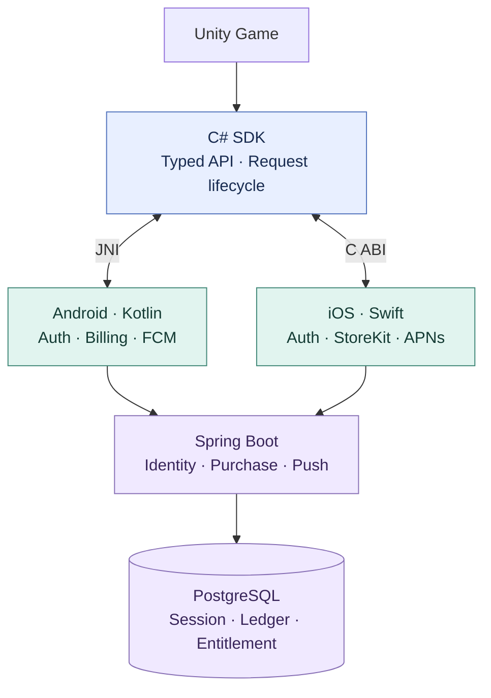

# GameBridge SDK

  

**Unity–Android–iOS 공통 게임 SDK. 비동기 요청 제어, 구매 데이터 정합성, 장애 복구 및 SDK 호환성을 중심으로 설계했습니다.**

공통 C# API로 인증·결제·푸시를 제공하며, Kotlin/Swift Native와 Spring Boot·PostgreSQL Backend의 책임 및 데이터 소유권을 분리했습니다.

> **[기술 설계 및 문제 해결](docs/TECHNICAL_OVERVIEW.md)** — 아키텍처 · Trade-off · Edge Case · 대표 사례 5개  
> **[공개 검증 근거](docs/VERIFICATION_EVIDENCE.md)** — 실행 기록 · 테스트 소스 · PR · CI · 배포 파일

개인 기술 포트폴리오 · [v0.1.2-dev Pre-release](https://github.com/CodingBot000/GameBridge_SDK/releases/tag/v0.1.2-dev) · Bridge Protocol v1

### 대표 설계·검증 성과

- **구매 복구:** Android API 34 AVD·iOS 18.6 Simulator의 LOCAL_MOCK에서 지급 응답 유실 후 SDK를 덮어 설치해 복구했습니다. 재동기화 후 각 원장 1건·100코인, 추가 회수 0건. [결과](docs/VERIFICATION_EVIDENCE.md#구매-데이터-정합성과-업데이트-복구)
- **Export 중단 복구:** 4개 쓰기 지점 장애 주입, PBX·콜백 검사 157개, 동일 폴더 재시도와 Host 편집 보호. [PR #11](https://github.com/CodingBot000/GameBridge_SDK/pull/11)
- **실제 플랫폼 인증:** 이전 버전의 Android API 34 AVD 및 iOS 18.6 Simulator에서 Native·Unity Google 실계정 로그인, 재실행 후 세션 복원, 인증 UI 취소 및 로그아웃을 확인했습니다. 0.1.2-dev 실계정 재검증은 미실행입니다. [Android 기록](docs/evidence/android-google-live-20261125.md) · [iOS 기록](docs/IOS_GOOGLE_OAUTH_VERIFICATION.md#session-lifecycle-and-automatic-callback-2026-11-23-kst)
- **검증 신뢰성·호환성:** DB 원장 제약 및 중복 응답 guard의 Mutation Test, C# 공개 메타데이터 383줄 동일, 선정 JVM/JNI·C ABI 비교. [검증 근거](docs/VERIFICATION_EVIDENCE.md)

**바로가기:** [아키텍처](#구조-한눈에-보기) · [기술적 핵심](#기술적-핵심) · [주요 기능](#주요-기능) · [검증 범위](#검증-현황과-제한사항) · [설치](#개발자용-pre-release-설치) · [Quick Start](#quick-start--unity-editor-offline)

## 구조 한눈에 보기



Unity는 요청 수명주기와 정제 이벤트, Native는 Provider 연동과 Keystore/Keychain 기반 토큰 보관, Backend는 세션 발급과 구매 지급을 담당합니다. UI callback만으로 재화를 지급하지 않습니다. Native 단독 소비와 EditorOffline Fake도 별도 지원합니다. [상세 Component Architecture 및 요청·구매 시퀀스](docs/TECHNICAL_OVERVIEW.md#2-아키텍처)

## 기술적 핵심

| 기술적 위험 | 설계 및 검증 | 상세 근거 |
| --- | --- | --- |
| **구매 응답 유실·중복 지급** | Attempt ID·body hash·DB UNIQUE·멱등 원장. 지급과 응답 수신을 별개 상태로 취급 | [구매 복구](docs/TECHNICAL_OVERVIEW.md#51-구매-응답-유실과-중복-지급-방어) |
| **Unity iOS Export 중단·Host 충돌** | 원본/예정 해시 Recovery Journal, 파일 단위 publish, 충돌 시 복구 중단 | [Export 복구](docs/TECHNICAL_OVERVIEW.md#52-unity-ios-export--중단-복구-및-host-변경-보호) |
| **비동기 요청 경쟁·이전 세션 callback** | 원자적 pending 소유권 제거·session/request/operation 대조·main-thread callback Pump. 늦은 응답 및 중복 guard Mutation 검증 | [요청 수명주기](docs/TECHNICAL_OVERVIEW.md#53-비동기-요청-경쟁과-지연-callback) |
| **Native 의존성과 OAuth 경계** | Meta 동적 Framework 4개 Embed·서명 및 Google AppController/UnityScene URL 경로 문제 분석·수정 | [iOS 장애 분석](docs/TECHNICAL_OVERVIEW.md#54-ios-native-의존성과-oauth-callback-장애-분석) |
| **SDK 리팩토링·업데이트** | 공개 계약 보존, 선정 API/ABI 비교, 독립 소비와 데이터 유지 검증 | [호환성 근거](docs/VERIFICATION_EVIDENCE.md#sdk-배포와-선정-apiabi-검증) |

인증 token·구매 proof·Push token 원문은 Native·Backend 경계에서 관리하고 Unity에는 정제 결과를 제공합니다. 공급자별 오류·세션 소유권을 유지하며 Android Store/FCM 공통화, Unity 상태 모델·진단·Capability Decoder 분리를 진행한 리팩토링도 기존 공개 계약과 함께 검증했습니다. [보안 및 데이터 소유권](docs/SECURITY.md) · [검증 전략과 불변조건](docs/TECHNICAL_OVERVIEW.md#6-검증-전략)

## 주요 기능

| 기능 | Unity API / 이벤트 |
| --- | --- |
| Authentication — Google·Apple·Facebook·Mock, 세션 | `SignInAsync`, `RestoreSessionAsync`, `SignOutAsync` |
| In-App Purchase — Play Billing / StoreKit | `GetProductsAsync`, `PurchaseAsync`, `SyncPurchasesAsync` |
| Entitlements — 서버 지급·권한 | `GetEntitlementsAsync`, `PurchaseUpdated` |
| Push — FCM / APNs | `RegisterPushAsync`, `UnregisterPushAsync`, `PushReceived`, `PushOpened` |
| Config & Diagnostics | `GetServiceConfigAsync`, `GetStatus`, `GetDiagnostics` |

### 지원 로그인

Android Google Credential Manager·Apple 웹 OAuth/Custom Tabs·Meta Classic, iOS GoogleSignIn·AuthenticationServices·Meta Limited/Classic adapter를 구현했습니다. 이전 Google 실계정 결과와 Apple/Facebook 미검증 상태는 [기능별 검증](docs/FEATURE_MATRIX.md)에서 구분합니다. [전체 API](docs/API.md) · [Provider·Host 설정](docs/USER_SETUP.md)

## 검증 현황과 제한사항

| 검증 영역 | 확인한 범위 |
| --- | --- |
| **양 플랫폼 버전 교체** | Unity 6000.5.8f1 · Android API 34 AVD · iOS 18.6 Simulator, LOCAL_MOCK `0.1.1-dev → 0.1.2-dev` 덮어 설치·세션 및 미완료 구매 복구. [결과](docs/evidence/bridge-client-refactor-verification.md#이전-공개-버전에서-업데이트) |
| **0.1.2-dev 회귀 및 배포** | 양 플랫폼 합성 PII·로그아웃 후 복원 차단/종료, iOS LOCAL_MOCK Push, 선정 API/ABI·Maven/R8·XCFramework·UPM 검증. [호환성](docs/COMPATIBILITY.md) |
| **Hosted CI** | [PR #22 HEAD 기본 5개 Job SUCCESS (재실행)](https://github.com/CodingBot000/GameBridge_SDK/actions/runs/45872763875), Unity E2E·Release Readiness SKIPPED. [CI 이력 및 배포 기준 실행](docs/VERIFICATION_EVIDENCE.md#github-hosted-ci) |

`EDITOR_OFFLINE`은 메모리 Fake, `LOCAL_MOCK`은 로컬 Native·Backend 개발 경로입니다. 가상 구매는 실제 스토어 거래가 아닙니다. 이전 Android API 34 AVD 및 iOS 18.6 Simulator의 Google 실계정 검증이 있으나 0.1.2-dev 재검증은 미실행입니다. 실제 Google token refresh/replay, Apple·Facebook 실계정, 실제 스토어 거래, 원격 FCM/APNs, 실기기, Unity 6000.4, 전체 Strict/Hosted Unity E2E·Release 검증은 미완료입니다. 기존 StoreKit 26.5 실패 및 weak client 1개 원인 미확정도 유지합니다.

이전 Android API 30·36 및 iOS 26.5 LOCAL_MOCK 기록은 현재 버전 실행과 분리합니다. 전체 상태: [FEATURE_MATRIX](docs/FEATURE_MATRIX.md) · [검증 한계](docs/TECHNICAL_OVERVIEW.md#8-검증-한계와-미해결-사항).

## 개발자용 Pre-release 설치

[GitHub Pre-release v0.1.2-dev](https://github.com/CodingBot000/GameBridge_SDK/releases/tag/v0.1.2-dev)의 공개 자산 6개를 같은 디렉터리에 받은 뒤 `shasum -a 256 -c SHA256SUMS`로 확인합니다.

| 대상 | 배포 형식 |
| --- | --- |
| Unity | `com.gamebridge.sdk-0.1.2-dev.tgz` (UPM, Unity 6000.5 이상 요구) |
| Android | `GameBridge-Maven-0.1.2-dev.zip` (Maven/AAR) |
| iOS | `GameBridgeNative-0.1.2-dev.xcframework.zip` (static XCFramework) |

상세 설치·Gradle 의존성·Xcode 링크·Host 설정은 [통합 가이드](docs/INTEGRATION.md)를 참고하세요. 포트폴리오 평가 및 비상업적 테스트 용도입니다. [라이선스](LICENSE) · [외부 의존성 고지](THIRD_PARTY_NOTICES)

## Quick Start — Unity Editor Offline

외부 계정·서버 없이 메모리 Fake로 공통 C# API를 살펴볼 수 있습니다. Unity 6000.5 계열 Package Manager에서 TGZ 또는 소스의 [package.json](unity/Packages/com.gamebridge.sdk/package.json)을 추가한 뒤 Editor Offline Demo를 Import합니다.

```csharp
// Unity 메인 스레드의 비동기 호출 지점에서 사용
var config = new GameBridgeConfig("gamebridge-sample", ProviderMode.EditorOffline, null);
var sdk = GameBridgeSdk.Create(config);
await sdk.InitializeAsync(config);
await sdk.SignInAsync(AuthProvider.MOCK);
var products = await sdk.GetProductsAsync();
sdk.Dispose();
```

[Offline Demo 실행 절차](unity/Packages/com.gamebridge.sdk/Samples~/Offline%20Demo/README.md) · [샘플 소스](unity/Packages/com.gamebridge.sdk/Samples~/Offline%20Demo/OfflineDemo.cs)

### Native / 플랫폼 Sandbox 연동

Android/iOS Player는 별도 Native 패키지·Host·Backend 설정을 사용합니다. [Native Demo](unity/Packages/com.gamebridge.sdk/Samples~/Native%20Demo/README.md) · [통합 가이드](docs/INTEGRATION.md) · [실제 Provider 설정](docs/USER_SETUP.md)

## 문서 안내

| 목적 | 문서 |
| --- | --- |
| 기술 설계·의사결정·사례·검증 | **[TECHNICAL_OVERVIEW](docs/TECHNICAL_OVERVIEW.md)** |
| SDK 연동 및 API | [INTEGRATION](docs/INTEGRATION.md) · [API](docs/API.md) |
| 구현 및 보안 상세 | [ENGINEERING_NOTES](docs/ENGINEERING_NOTES.md) · [SECURITY](docs/SECURITY.md) |
| 공개 검증 근거 | **[VERIFICATION_EVIDENCE](docs/VERIFICATION_EVIDENCE.md)** · [COMPATIBILITY](docs/COMPATIBILITY.md) · [FEATURE_MATRIX](docs/FEATURE_MATRIX.md) |

상세 개발 이력과 실패 원본 참조는 [START_HERE](START_HERE.md)에서 확인할 수 있습니다. 이 프로젝트는 개인 기술 포트폴리오이며 상용 게임 출시나 외부 고객 운영 실적을 의미하지 않습니다.
