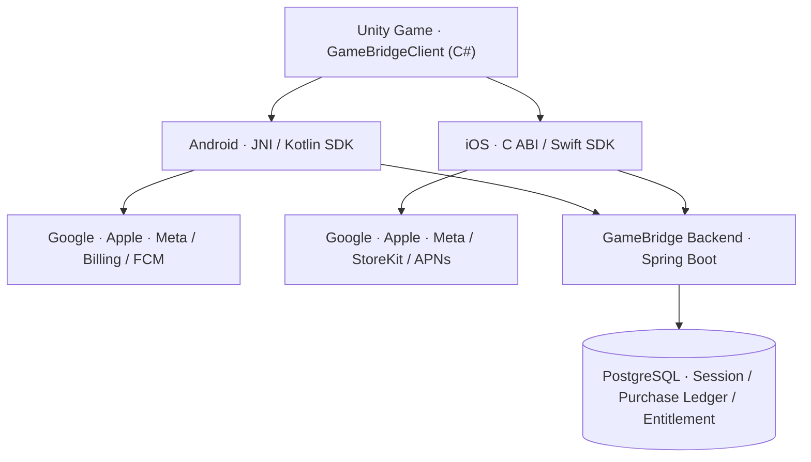

# GameBridge SDK

  

**Unity 게임에서 Android·iOS의 인증·결제·푸시 기능을 하나의 C# API로 사용하는 모바일 게임 SDK입니다.** Unity C# SDK와 Kotlin/Swift Native 브리지, Spring Boot·PostgreSQL Backend를 직접 연결해 플랫폼별 구현 차이와 서버 데이터의 책임을 분리했습니다.

> **프로젝트 상태:** 개인 개발 포트폴리오 `0.1.1-dev`입니다. 상용 배포용 릴리스가 아니며, 기능 구현과 실제 실행·검증 범위는 구분합니다.

**바로가기:** [주요 기능](#주요-기능) · [아키텍처](#구조-한눈에-보기) · [기술적 핵심](#기술적-핵심) · [Quick Start](#quick-start--unity-editor-offline) · [검증 결과](#검증-현황과-제한사항)

**대표 검증 성과:** Android·iOS Native/Unity Google 실계정 로그인·복원·취소·로그아웃, 양 플랫폼 `0.1.0-dev → 0.1.1-dev` 업데이트 후 세션·미완료 구매 복구 및 중복 지급 방지를 검증했습니다.

## 주요 기능

| 기능 | Unity에서 사용하는 기능 | 핵심 API / 이벤트 |
| --- | --- | --- |
| **Authentication** | Google·Apple·Facebook 로그인, 세션 복원·로그아웃 | `SignInAsync`, `RestoreSessionAsync`, `SignOutAsync` |
| **In-App Purchase** | Google Play Billing / Apple StoreKit 상품 조회·구매·복원 | `GetProductsAsync`, `PurchaseAsync`, `SyncPurchasesAsync` |
| **Entitlements** | 서버가 관리하는 코인 잔액·프리미엄 권한 | `GetEntitlementsAsync`, `PurchaseUpdated` |
| **Push Notifications** | FCM / APNs 등록·해제, 수신·열기 이벤트 | `RegisterPushAsync`, `PushReceived`, `PushOpened` |
| **Config & Diagnostics** | 점검 설정·캐시, SDK 상태·기능·진단 조회 | `GetServiceConfigAsync`, `GetStatus`, `GetDiagnostics` |

### 지원 로그인

| 제공자 | Android | iOS |
| --- | --- | --- |
| **Google** | Credential Manager · 실계정 AVD 검증 | GoogleSignIn 9.2.0 · 실계정 Simulator 검증 |
| **Apple** | 웹 OAuth · Custom Tabs | AuthenticationServices |
| **Facebook** | Meta Classic Login | Meta Limited / Classic Login |
| **Mock** | 개발용 `LOCAL_MOCK` | 개발용 `LOCAL_MOCK` |

로그인 공급자의 원본 토큰과 인증 증빙은 Native·Backend에서 처리하고, Unity에는 사용자/세션 결과만 전달합니다. [인증·Host 설정](docs/USER_SETUP.md) · [C# API 전체](docs/API.md)

## 구조 한눈에 보기



**클라이언트는 인증·구매 요청을 전달하고, Backend는 세션 발급과 재화 지급의 최종 권한을 갖습니다.** 구매 UI의 성공 메시지만으로 재화를 지급하지 않고 서버 원장과 권한 조회 결과를 사용합니다.

## 기술적 핵심

- **플랫폼 경계를 넘는 비동기 SDK:** Unity C# 공통 API와 Android JNI·iOS C ABI를 연결했습니다. `requestId`·세션 세대·메인 스레드 디스패치로 중복 완료, 타임아웃, 취소, 늦은 콜백을 관리합니다.
- **인증·세션 보안:** Provider 증명과 nonce challenge를 Backend에서 검증하고, Native 보안 저장소(Android Keystore / iOS Keychain)를 사용합니다. Unity 이벤트·로그에는 인증 토큰 원문을 노출하지 않도록 경계를 분리했습니다.
- **멱등 구매·재화 관리:** PostgreSQL 거래 유일성 제약과 멱등 원장으로 중복 지급을 방어하고, 구매 결과·서버 지급·재화 조회 및 응답 유실 후 복구를 별개 상태로 다룹니다.
- **Unity iOS 연동 문제 해결:** Google OAuth의 AppController·UnityScene URL 경로를 분리해 처리하고, Meta 동적 Framework 4개의 Host 앱 Embed·서명 문제를 수정했습니다. Export 후처리의 반복 적용과 충돌 방지도 검증했습니다.
- **SDK 버전 관리·패키징:** Maven/AAR·R8, XCFramework·Swift 소비, UPM의 버전 정합성과 체크섬을 검사하고 기존 SDK 업데이트 시 선정 API·ABI 및 세션·미완료 구매 복구를 검증했습니다.

구현 근거와 장애 분석: [설계·Edge Case·문제 해결](docs/ENGINEERING_NOTES.md) · [보안·데이터 소유권](docs/SECURITY.md)

## Quick Start — Unity Editor Offline

외부 계정·개발 서버 없이 SDK 인터페이스를 살펴볼 수 있는 **Unity Editor 전용 메모리 Fake** 예제입니다.

1. Unity **6000.5 계열** 프로젝트에서 Package Manager → **Add package from disk**로 [`package.json`](unity/Packages/com.gamebridge.sdk/package.json)을 추가합니다.
2. 패키지 **Samples → Editor Offline Demo**를 Import합니다. UI에는 `com.unity.ugui`가 필요합니다.
3. Scene의 GameObject에 `OfflineDemo`를 붙이고 호환되는 EventSystem을 준비합니다.
4. Editor Play에서 로그인·상품 목록·가상 구매 흐름을 확인합니다.

공통 C# API 호출 형태:

```csharp
// Unity 메인 스레드의 비동기 호출 지점에서 사용
var config = new GameBridgeConfig("gamebridge-sample", ProviderMode.EditorOffline, null);
var sdk = GameBridgeSdk.Create(config);
await sdk.InitializeAsync(config);
await sdk.SignInAsync(AuthProvider.MOCK);
var products = await sdk.GetProductsAsync();
sdk.Dispose();
```

[실행 가능한 Offline Demo](unity/Packages/com.gamebridge.sdk/Samples~/Offline%20Demo/README.md) · [소스](unity/Packages/com.gamebridge.sdk/Samples~/Offline%20Demo/OfflineDemo.cs)

### Native / 플랫폼 Sandbox 연동

Android/iOS Player는 별도 Native 패키지·Host·Backend 설정을 사용합니다. 플랫폼 인증 설정을 완료한 뒤에도 동일한 Unity API로 호출합니다.

```csharp
var user = await sdk.SignInAsync(AuthProvider.GOOGLE);
var session = await sdk.RestoreSessionAsync();
await sdk.SignOutAsync();
```

[Native Demo](unity/Packages/com.gamebridge.sdk/Samples~/Native%20Demo/README.md) · [Native 통합 및 빌드 절차](docs/INTEGRATION.md) · [설정](docs/USER_SETUP.md)

## 검증 현황과 제한사항

| 검증 영역 | 확인한 결과 | 근거 |
| --- | --- | --- |
| **SDK 업데이트·하위 호환성** | Android API 34·iOS 18.6에서 앱·DB 유지 후 버전 교체, 세션·미완료 구매 복구, 원장 각 1건/100코인 | [Batch A](docs/evidence/batch-a47-dev-compatibility.md) · [Batch B](docs/evidence/batch-b48-compatibility.md) |
| **Unity·OS 호환성** | Unity 6000.5.8f1, Android API 30·34·36 및 iOS 18.6·26.5 LOCAL_MOCK Player | [호환성](docs/COMPATIBILITY.md) |
| **패키징·계약** | 0.1.1-dev Maven·XCFramework·UPM, SHA-256, 기존 C# 소비자, 선정 JVM 4개 클래스·C ABI 5개 심볼 비교 | [Batch A](docs/evidence/batch-a47-dev-compatibility.md) |
| **Google 실계정** | Android API 34 AVD / iOS 18.6 Simulator Native·Unity 로그인, UI 취소, 앱 재실행 후 복원, 로그아웃 및 서버 세션 폐기 | [Android](docs/evidence/android-google-live-20261125.md) · [iOS](docs/IOS_GOOGLE_OAUTH_VERIFICATION.md) |
| **Unity iOS 콜백·Export 복구** | PBX·콜백 검사 157개, 네 쓰기 지점의 중단 복구, Host 편집 보존, Framework Embed·서명 | [PR #11](https://github.com/CodingBot000/GameBridge_SDK/pull/11) |
| **Hosted CI** | Inventory·Backend·Android·Swift/iOS·Basic **5개 Job 성공** | [PR #14 CI](https://github.com/CodingBot000/GameBridge_SDK/actions/runs/45578953794) |

`EDITOR_OFFLINE`은 메모리 Fake, `LOCAL_MOCK`은 로컬 Native·Backend 개발 경로입니다. 가상 구매는 실제 스토어 거래가 아닙니다. 실제 Google 토큰 갱신/replay, Apple·Facebook 실계정, 실제 스토어 거래, 원격 FCM/APNs, 실기기, Unity 6000.4 및 전체 Strict/Hosted Unity E2E·Release 검증은 미완료이며 기존 StoreKit 26.5 실패도 유지합니다. [검증 범위](docs/FEATURE_MATRIX.md) · [알려진 제한](docs/ENGINEERING_NOTES.md#알려진-제한과-선택적-후속-작업)

**검증 환경:** Unity 6000.5.8f1 · Android API 30/34/36 AVD(빌드 API 36, JDK 21) · iOS 18.6/26.5 Simulator(Xcode 26.6) · Spring Boot/PostgreSQL. UPM 최소 Unity는 6000.5이며 모든 OS·Unity 버전의 지원을 보증하지 않습니다. 개발자용 배포 후보는 로컬에 있으며 GitHub Pre-release는 미공개입니다.

## 문서 안내

| 문서 | 내용 |
| --- | --- |
| [API](docs/API.md) · [통합 가이드](docs/INTEGRATION.md) | C# API·오류·이벤트, Native 패키징과 Host 설정 |
| [설계·문제 해결](docs/ENGINEERING_NOTES.md) · [보안](docs/SECURITY.md) | 브리지 경계·Edge Case·원장·토큰 소유권 |
| [Android Google](docs/evidence/android-google-live-20261125.md) · [iOS Google](docs/IOS_GOOGLE_OAUTH_VERIFICATION.md) | 실제 인증·세션 수명주기 검증 |
| [진행 기록](docs/PROGRESS.md) · [변경 이력](docs/CHANGELOG.md) | 시점별 테스트 근거와 개발 이력 |
| [호환성](docs/COMPATIBILITY.md) · [사용자 설정](docs/USER_SETUP.md) | 검증한 조합·플랫폼 연동 준비 |
| [기능 매트릭스](docs/FEATURE_MATRIX.md) · [최종 보고](docs/FINAL_REPORT.md) | 실제 검증 범위와 완료 판정 |

이 저장소는 개인 기술 포트폴리오이며, 상용 게임 출시나 외부 고객 운영 실적을 의미하지 않습니다.
