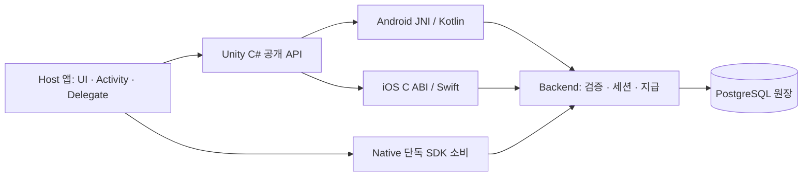

# 설계·Edge Case·문제 해결

개인 SDK 포트폴리오의 기술 설명이다. 상용 서비스 적용·고객 지원·운영 장애 대응 실적으로 제시하지 않는다. 실행 범위와 제한의 기준은 [호환성·검증 범위](COMPATIBILITY.md)다.

## 구조와 데이터의 권위

| 계층 | 책임·소유 데이터 | 실제 구현 |
| --- | --- | --- |
| Host | 플랫폼 앱 등록·Activity/window·notification delegate·사용자 동의·표시와 앱 수명 | [Android forwarding 예제](../android/host-examples/UnityPushForwarding.kt.example), [SwiftUI AppDelegate](../ios/SampleApp/GameBridgeSampleApp.swift) |
| Unity | typed 공개 API, request/session ID, 대기·timeout·취소, main-thread pump, 정제 이벤트 | [GameBridgeClient](../unity/Packages/com.gamebridge.sdk/Runtime/GameBridgeClient.cs), [RequestRegistry](../unity/Packages/com.gamebridge.sdk/Runtime/Core/RequestRegistry.cs), [GameBridgeSdk](../unity/Packages/com.gamebridge.sdk/Runtime/GameBridgeSdk.cs) |
| Android Native | Activity 연결, Google/Billing/FCM adapter, HTTP·세션·Keystore 저장, callback | [BridgeFacade](../android/sdk-unity-bridge/src/main/kotlin/com/gamebridge/bridge/BridgeFacade.kt), [Native SDK](../android/sdk-android/src/main/kotlin/com/gamebridge/android) |
| iOS Native | Swift actor/async 경계, Apple/StoreKit adapter, Keychain·HTTP, C ABI callback byte 전달 | [Bridge.swift](../ios/UnityBridge/Bridge.swift), [Core](../ios/Sources/GameBridgeCore), [Apple](../ios/Sources/GameBridgeApple) |
| Backend | identity/proof 검증, opaque 세션, 계정 binding, transaction·멱등성·지급·token 소유권 | [Sessions](../backend/src/main/kotlin/com/gamebridge/session/Sessions.kt), [Purchase](../backend/src/main/kotlin/com/gamebridge/purchase), [migration](../backend/src/main/resources/db/migration) |

C# public result에는 access/refresh token, ID token, purchase proof, Push token 원문을 반환하지 않는다. Native가 토큰 갱신·보안 저장소를 소유한다. 서버는 세션 token hash와 환경·계정 범위를 확인하고, 필요한 Push token/구매 증빙은 서버 암호화 경계 안에서 관리한다. UI는 스토어 callback만으로 코인을 더하지 않고 서버 entitlement를 표시한다. 세부 저장·삭제 정책은 [SECURITY](SECURITY.md)에 있다.

공통 wire는 UTF-8 JSON과 `protocolVersion`, `sdkSessionId`, `requestId`를 사용한다. Android는 C# `AndroidJavaProxy`→Kotlin callback, iOS는 Swift `@_cdecl`→AOT delegate→즉시 byte 복사→main-thread pump다. 생성된 IL2CPP/C++ 코드를 직접 개발한 C++ SDK로 제시하지 않는다. [AndroidTransport](../unity/Packages/com.gamebridge.sdk/Runtime/Platforms/AndroidTransport.cs), [IosTransport](../unity/Packages/com.gamebridge.sdk/Runtime/Platforms/IosTransport.cs), [wire schema](../contracts/bridge.schema.json)를 함께 읽으면 경계를 확인할 수 있다.

## 인증·구매·Push의 데이터 흐름

| 기능 | 흐름 | 결과의 권위 |
| --- | --- | --- |
| 인증 | Host의 로그인 요청 → Native Provider/nonce challenge → Backend identity 검증·session 발급 → Native 보안 저장소 → C# user/session snapshot | Provider 증빙은 Native와 Backend에 남고 C#은 UI 상태만 표시 |
| 구매 | 플랫폼 상품 조회/구매 → Native의 계정 binding·proof → Backend 검증·멱등 원장·지급 → Native finish/서버 finalizer → 결과·후속 이벤트 및 entitlement 조회 | 지급은 서버 원장. pending·Task timeout과 실제 거래 완료를 분리 |
| Push | 명시적 권한/등록 → Host/Native token → Backend session·installation 결속 → sender/Host 수신 → Native route/dedupe → C# typed event | token은 서버/Native에만, UI에는 허용 route와 fingerprint·상태 |

LOCAL_MOCK은 개발 auth·가짜 proof·simulated Push로 위 계층 경계를 확인한다. 실제 Provider의 키·서명·계정·원격 전달 성공은 별도다.

## BridgeFacade와 GameBridgeClient의 내부 책임

Android의 Google과 Apple/Facebook adapter는 각자 StoreLifecycle을 소유합니다. 공통 수명주기는 첫 접근의 구매 이벤트 구독, 매 접근의 Host 연결, Store 정리를 맡습니다. FCM 공통 함수도 permission·token callback·timeout까지만 처리하고 공급자별 오류의 상세와 등록 HTTP 호출 경계는 유지합니다.

Unity는 기존 public 상태 모델을 같은 assembly의 `SdkStatusModels.cs`에 두고 diagnostics와 capability의 JSON 변환을 두 내부 Decoder로 분리합니다. 초기화·종료, 요청 세대, Host 이벤트 큐는 기존 Facade에서 관리합니다. [리팩토링 검증](evidence/bridge-client-refactor-verification.md)

## 대표 Edge Case

| 입력·상황 | 방어 조건 / 기대 동작 | 실제 근거·관측 |
| --- | --- | --- |
| 같은/다른 설정의 동시 초기화 | 같은 설정은 초기화 작업 공유, 다른 설정 거부; 종료 후 새 세대 | [Core/managed 회귀](evidence/p10-batch34-regression.json), Kotlin10·Swift12·managed418 검사 범위 |
| timeout·취소·중복·늦은 callback | pending 소유자를 원자 제거하고 Task는 최대 한 번 완료. timeout은 실제 스토어 거래 취소가 아님 | `RequestRegistry.RemoveOwned/Finish`와 [변이·정상 복원](evidence/p10-batch34-regression.json). duplicate guard 제거 시 음성 검증이 실패 |
| 이전 session callback | session/request/operation을 함께 대조하고 새 client에 이전 결과를 전달하지 않음 | Native·managed cohort와 [Android Player](evidence/p10-batch34-unity-android.json), [iOS Player](evidence/p10-batch34-unity-ios.json) |
| 동일 거래·다른 멱등키 / 동일 키·다른 body | 거래 unique 제약과 body hash/멱등 원장을 함께 사용. 충돌은 재지급하지 않음 | [TC11/의도 변이1·복원](evidence/p10-batch34-regression.json), 실제 Player의 원장1건·100코인 대조 |
| 지급 후 응답 유실 | 동일 attempt·거래·계정으로 재조회/복구. 이미 끝난 Task를 다시 완료하지 않음 | [재시작·복구 범위](evidence/p09-batch26-integrated.md), [구매 회귀 감사](evidence/p11-batch34-task-audit.json). LOCAL_MOCK 복구와 실제 스토어 복구는 분리 |
| Push 중복·logout·계정 전환 | messageId dedupe와 home/store allowlist, session 소유권, 해제/logout token 삭제 | [Android Push](evidence/p10-batch32-android-push-c.json), [iOS Push](evidence/p10-batch32-ios-push.json). simulated 전달이며 FCM/APNs 실전송 아님 |
| 원문 토큰·PII가 callback에 포함 | 허용된 typed 필드만 공개하고 key/proof/email/phone 원문을 진단 결과에서 제외 | [새 Android PII](evidence/p10-batch34-unity-android.json), [새 iOS PII](evidence/p10-batch34-unity-ios.json), [HTTP shape capture](evidence/p11-batch34-openapi-synthetic.json) |
| Scene 생성·전환·해제와 반복 종료 | persistent dispatcher, 완료 후 pending 정리, Dispose 후 singleton·callback 연결 해제 | [실제 Player100 cycle/1000 frame](evidence/p10-batch34-unity-performance.json). pending0, weak client1은 아래 미확정 관측으로 보존 |

정상 시험·예상 음성 실패·checker·helper·sample·Player를 합산하지 않는다. 예를 들어 managed418은 별도 검사 cohort이며 Python263개의 시험 수에 더하지 않는다.

## 문제 해결 1 — Unity 빌드와 runtime ADB 수명 충돌

- **증상:** APK가 만들어졌지만 설치 전 소유권 guard가 중단했다. Unity batch 종료 뒤 runtime ADB 서버 PID가 유지되지 않았다.
- **초기 조사 방향:** Player/SDK 결함과 설치 이전 도구 수명 문제를 분리했다. 우선 build exit/APK 존재와 서버 PID·포트·실행파일을 확인했다.
- **데이터:** [분리 실험](evidence/p10-batch32-build-adb-isolation.json)은 build exit0/APK 존재와 runtime PID 생존을 각각 기록한다. [이력](evidence/p10-batch32-integrated.md)에 초기 잘못된 foreground 옵션 거부도 남겼다.
- **대응:** runtime5037과 build5038을 분리하고, 비어 있는 endpoint에 직접 생성한 foreground 서버만 관리했다. 이미 사용 중인 사용자 서버를 재시작하지 않았다. `harness/adb_build_isolation.py`는 포트 충돌·실행파일/PID 불일치에서 실패한다.
- **검증:** [새 Android 소비](evidence/p10-batch34-unity-android.json)에서 분리 endpoint를 사용해 실제 JNI·PII/Backend·원장을 확인했다. 소유권 음성과 자기 프로세스 정리 unit도 유지했다.
- **한계:** 개별 소비자 성공은 전체 Strict58 lane의 모든 자원 소유 계약 완성을 뜻하지 않는다.

## 문제 해결 2 — OS별 파일 열거 순서에 따른 OpenAPI CI 실패

- **증상:** 로컬 정상 검사와 달리 [run44269328731](https://github.com/CodingBot000/GameBridge_SDK/actions/runs/44269328731)의 Ubuntu inventory가 동일 path의 source binding 비교에서 실패했다.
- **초기 가설·조사:** API 구현 차이와 검사기 순서 의존성을 분리했다. 실패 assertion과 두 Controller의 동일 path/profile/header 집합을 대조했다.
- **좁힌 근거:** 최초 비교가 `Path.rglob` 순서의 list를 그대로 비교했다. binding의 의미가 같아도 OS별 열거 순서가 달라졌다.
- **수정:** source/profile/header를 의미 단위로 정규화하면서 중복 binding·누락·실제 profile/header 변경은 계속 거부했다. [검사기](../harness/check-openapi.py), [음성 시험](../harness/test_openapi_contract.py).
- **검증:** [run44287600414](https://github.com/CodingBot000/GameBridge_SDK/actions/runs/44287600414)의 Ubuntu 정상·순서 반전·중복·누락/DTO 시험과 Python263이 통과했다. 실패 run과 후속 수정 이력을 보존했다.
- **한계:** 정렬 문제 해결과 HTTP 전체 의미·실제 Provider 검증은 별개다. BUG-017의 잔여 범위는 [API](API.md)에 명시한다.

## 문제 해결 3 — Android 전체화면 안내와 Push 복구 실패의 분리

- **증상:** 전용 AVD의 전체화면 교육 안내가 테스트 진행을 가렸다. 이후 Push B 실행은 일부 수신/메인스레드 확인 뒤 네트워크 복구 구간에서 실패했다.
- **가설·데이터:** UI 방해와 SDK·네트워크 재연결 실패를 같은 원인으로 취급하지 않았다. [B 실패](evidence/p10-batch32-android-push-b.json)는 부분 marker, 약90초 대기와 exception type을 보존한다. 예외 원문이 없어 정확한 내부 원인은 추정 범위다.
- **대응:** 사용자에게 이미 허용된 전용 AVD에서 식별 가능한 안내만 명시 opt-in으로 닫았다. 새 기기에서 동일 APK·GUI receipt를 유지하고 재연결 marker와 DB token 상태를 다시 확인했다.
- **검증:** [C 후속](evidence/p10-batch32-android-push-c.json)은 receive/dedupe/main-thread·재연결·session 전환·해제/logout PASS, token0을 기록한다.
- **한계:** 교육 안내 대응은 확인했지만 B의 reconnect timeout 근본 원인이 제품 수정으로 해결됐다고 단정하지 않는다. 실제 FCM, OS 전체 망 단절, 프로세스 재시작 검증으로 확대하지 않는다.

## 문제 해결 4 — Unity iOS OAuth Scene 콜백 경계

- **증상:** PR #7 AppController 연결만 적용한 Player에 합성 Google 등록 URL 전달 시 Native ABI 진입 0건, Unity C# URL 이벤트 1건. stock UnityScene의 독립 URL 경로가 원인이었다.
- **수정:** [PR #8](https://github.com/CodingBot000/GameBridge_SDK/pull/8)의 opt-in Export hook에서 AppController와 UnityScene warm/cold 경로가 Google 등록 scheme을 Native에서 먼저 소비하도록 했다. 기존 Host 경로·충돌 감지·반복 적용을 보존했다.
- **검증:** signed Player 합성 warm URL ABI 1회, Unity URL 이벤트·신규 Backend 세션 0건. 71개 PBX/URL 검사·새 Export/빌드 통과. 같은 자동 Export 앱의 실제 Google 로그인·복원·취소·로그아웃도 확인했다.
- **경계:** 실제 OAuth ABI 진입은 0건. cold Scene URL 직접 주입·실계정 refresh/replay는 NOT_RUN이며 실제 로그인 성공과 합성 callback 검증을 구분한다. [iOS Google 검증 기록](IOS_GOOGLE_OAUTH_VERIFICATION.md).

## 제한 조사 — weak client1개

조사 범위는 기존 [Player 실측](evidence/p10-batch34-unity-performance.json)과 현재 cleanup 소스다. 추가 재현·제품 수정 시도는 **0회**다. 동일 실험을 반복해 성공 수를 늘리지 않았다.

- 120회 중20회 warmup을 제외한100회 측정, frame1000, 완료 후 pending 최대0, forced managed GC와5회 yield 후 weak client1을 관측했다.
- Unity allocator 관측은48,525,032→48,589,370 bytes, managed used는1,232,896→1,359,872 bytes다. 두 시점의 관측만 있으며 cycle별 증가 곡선·heap root·native heap 추적은 없다.
- [GameBridgeSdk](../unity/Packages/com.gamebridge.sdk/Runtime/GameBridgeSdk.cs)의 `OnDisposed`는 active를 비우고 driver를 Detach한다. [IosTransport](../unity/Packages/com.gamebridge.sdk/Runtime/Platforms/IosTransport.cs)는 static current·Message·queue를 정리한다. registry는 pending을 비우고 취소/timeout 등록을 using 범위에서 해제한다.
- 계측의 [Run async 프레임](../tests/UnityPlayerPerformance/PlayerPerformance.cs)이 끝나기 전에 GC/weak count를 읽는다. 마지막 await/계측 참조 또는 런타임 보수적 root가 원인일 가능성은 **가설**이며, 실제 root를 확인하지 않았다. SDK 내부/Native 수명에 의한 참조 역시 완전히 배제하지 못한다.

**판정:** 원인·누수 여부 미확정. 지속적 증가나 크래시를 재현한 자료가 없고 이번 검토에서 새로운 P0 결함은 확인되지 않았다. “누수가 없다”, “weak1을 해결했다”는 주장은 하지 않는다. 포트폴리오 Known Limitation으로 공개하고 이 조사를 종료한다. 이후 실제 제품화가 필요할 때 clean-stack 대조·root capture·N별 반복 실험을 선택할 수 있다.

## 알려진 제한과 선택적 후속 작업

| 항목 | 현재 상태 | 제품화를 선택할 경우의 후속 |
| --- | --- | --- |
| 전체 Strict | NOT_RUN, 기존 E1 DEFERRED_ENV/2·E2 생성/전 lane 소유권 배선 미완료 | 안전한 별도 환경에서 계약 완성 후 최대1회. 기존 P05 실패 유지 |
| StoreKit | P05-T03 FAIL, ENV-STOREKIT-26 OPEN,18.6 간헐 위험 | 전용 Runtime·테스트 계정·시나리오별 재현. LOCAL_MOCK 통과로 덮지 않음 |
| 외부 Provider (기존 13건 원장) | 문서36 당시 WAITING_USER 집계 보존. Android API 34 AVD와 iOS 18.6 Simulator Native/Unity Google 실제 인증 수명주기 PASS (세부 범위는 [기능 매트릭스](FEATURE_MATRIX.md)) | 실제 갱신/replay·실기기·다른 Provider는 별도 승인된 환경에서 검증 |
| weak1 / 추가 profiling | 미확정 / Android JNI heap·iOS continuation·CPU blocking NOT_RUN | 실제 심각한 결함 조사가 필요할 때만 측정. 지금 자동 필수 배치로 넘기지 않음 |
| OpenAPI |24 operation/DTO23·실제/합성 응답 구조 대조, BUG-017 OPEN | 문서의 SSE/Map 세부 계약을 기계 검사에 더 연결할 수 있음 |
| 환경·출시 | Unity 한 버전·일부 OS, self-hosted/Release·실기기 미검증 | 지원 확대 또는 출시를 별도로 결정한 경우에만 진행 |

개발 종료 판정은 [FINAL_REPORT](FINAL_REPORT.md), 실현된 호환 범위는 [COMPATIBILITY](COMPATIBILITY.md)를 따른다. 위 목록은 선택적 backlog이며 자동 재개 계획이 아니다.
