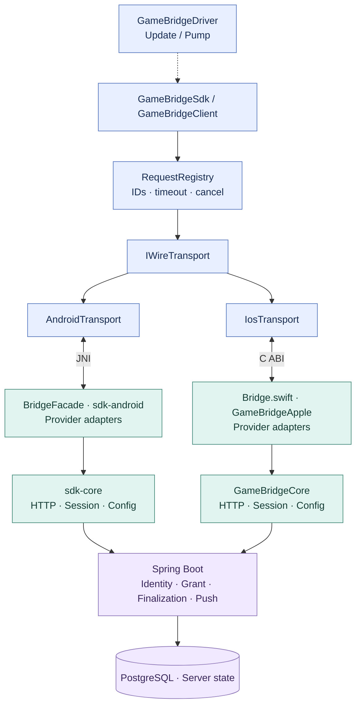
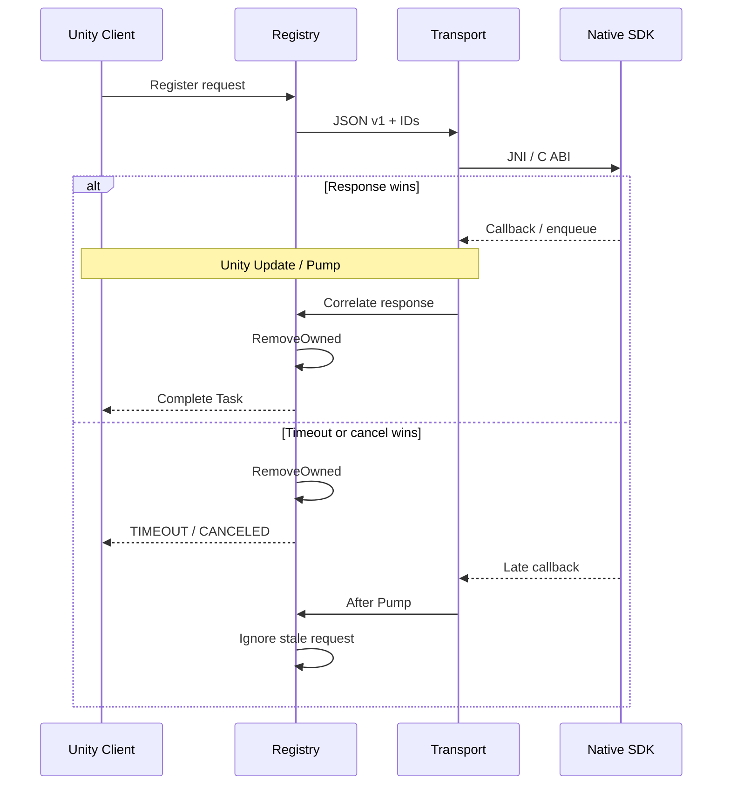
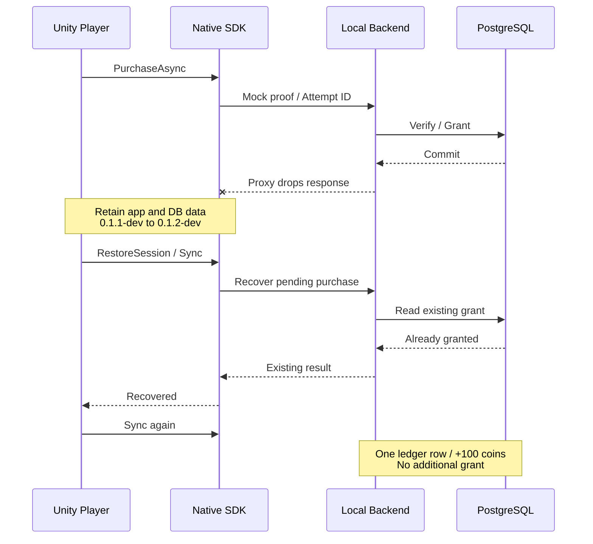
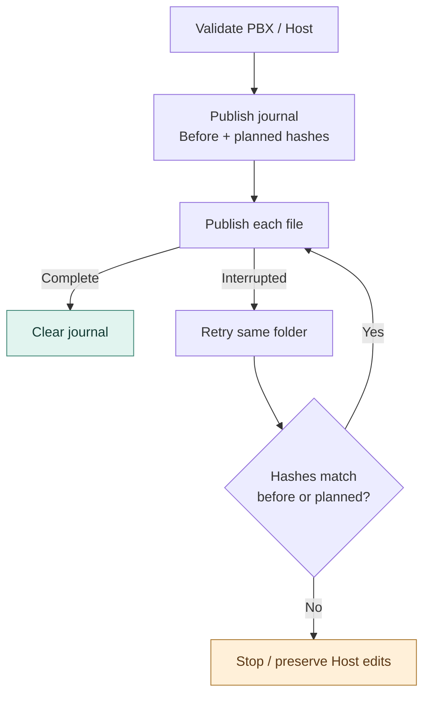
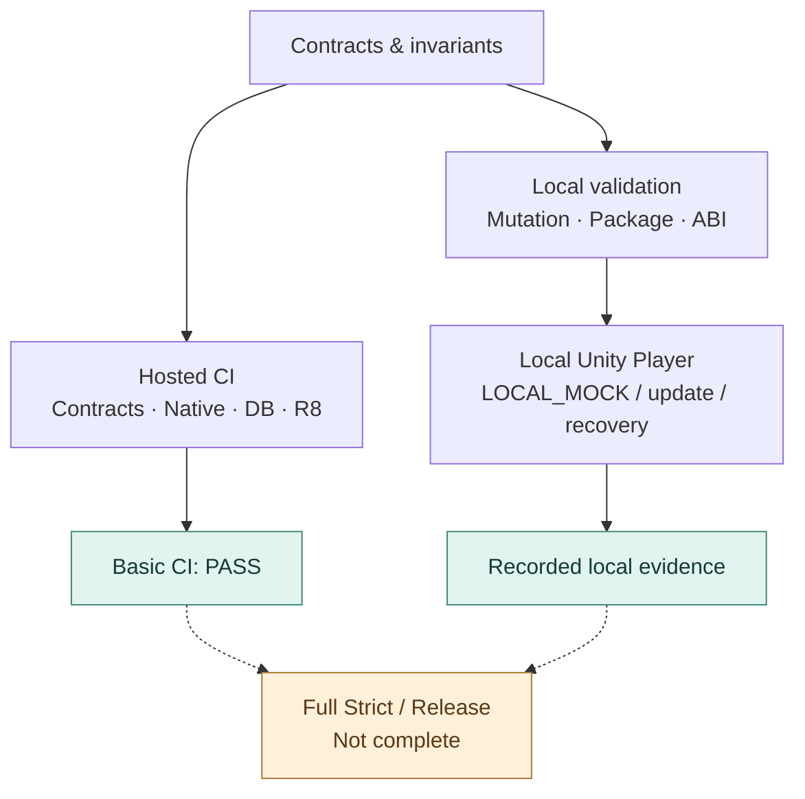

# GameBridge SDK — Technical Overview

> **Unity · Android · iOS 게임 플랫폼 SDK의 설계, 기술적 의사결정, 실패 대응 및 검증 근거**
>
> 개인 기술 포트폴리오 · [v0.1.2-dev Pre-release](https://github.com/CodingBot000/GameBridge_SDK/releases/tag/v0.1.2-dev) · Bridge Protocol v1  
> 검토 기준 소스: [main `99b1575`](https://github.com/CodingBot000/GameBridge_SDK/commit/99b157546c7a7f76d65f7678b7a3dca4f19b7efd). 기존 소스와 검증 기록을 설명하며 새 제품 기능이나 실행 결과를 추가하지 않습니다.
>
> **[공개 검증 근거 바로가기](VERIFICATION_EVIDENCE.md)** — 주장별 소스·테스트·실행 결과를 연결하고, 공개 기록과 비공개 로컬 원본의 범위를 구분합니다.

[아키텍처](#2-아키텍처) · [설계 선택](#3-설계-선택과-trade-off) · [Edge Case](#4-failure-model과-불변조건) · [문제 해결](#5-대표-기술-사례) · [검증 전략](#6-검증-전략) · [배포와 호환성](#7-sdk-배포와-호환성) · [제한사항](#8-검증-한계와-미해결-사항)

## 1. Engineering Objectives

GameBridge는 Unity 게임이 Android·iOS의 인증·결제·푸시 기능을 동일한 C# 인터페이스로 사용할 수 있도록 구성한 SDK입니다. 단순한 API 통합보다 다음 위험을 설계 및 검증 대상으로 삼았습니다.

| 기술적 위험 | 설계 목표 | 대표 관측 |
| --- | --- | --- |
| 비동기 응답 경쟁, 지연 콜백 | 요청 소유권·SDK 세션 격리 및 최대 한 번 Task 완료 | 중복 응답 방어 제거 시 예상 실패, 정상 대조 통과. [사례](#53-비동기-요청-경쟁과-지연-callback) |
| 지급 후 응답 유실·앱 재시작 | 서버 원장 권위, 중복 지급 방어, 미완료 구매 복구 | 양 플랫폼 LOCAL_MOCK 업데이트 후 각 원장 1건·100코인. [사례](#51-구매-응답-유실과-중복-지급-방어) |
| Unity iOS Export 중단·Host 충돌 | 변경 복구, 반복 적용, 외부 변경 보호 | PBX·콜백 검사 157개, 4개 쓰기 지점 중단 주입. [사례](#52-unity-ios-export--중단-복구-및-host-변경-보호) |
| SDK 내부 변경 | 공개 계약과 소비자 호환성 유지 | C# 공개 메타데이터 383줄 동일, 선정 JVM·JNI·C ABI 비교. [사례](#55-sdk-리팩토링과-소비자-호환성) |

위 결과는 서로 다른 버전과 환경에서 확보한 증거입니다. 각 사례의 상세 범위를 아래에 명시합니다.

## 2. 아키텍처

### 2.1 Component architecture — 플랫폼과 책임 경계

실제 코드의 주요 경계를 압축한 개념도입니다. 파란색은 Unity 관리 코드, 녹색은 Native, 보라색은 Backend 및 DB입니다. 모든 호출·컴파일 의존성을 나타내지는 않습니다. JNI/C ABI는 각각 C# Transport와 Kotlin/Swift Bridge 사이의 경계입니다. `EditorOfflineTransport`는 별도 메모리 Fake이며 Native·Backend와 연결되지 않습니다. Native 앱은 Unity를 거치지 않고 플랫폼 SDK를 직접 소비할 수 있습니다. Host와 Provider 설정은 아래 책임표 및 통합 지침을 따릅니다.

| 경계 | 소유 책임 / 데이터 | 소스 |
| --- | --- | --- |
| Host | UI·Activity/window·권한·앱 수명·플랫폼 등록 | [Android Host 예제](../android/host-examples), [iOS Host 예제](../ios/host-examples) |
| Unity | 공통 typed API, SDK 세대, 요청 상관관계, timeout/cancel, 정제 이벤트 | [GameBridgeClient](../unity/Packages/com.gamebridge.sdk/Runtime/GameBridgeClient.cs), [RequestRegistry](../unity/Packages/com.gamebridge.sdk/Runtime/Core/RequestRegistry.cs), [GameBridgeSdk](../unity/Packages/com.gamebridge.sdk/Runtime/GameBridgeSdk.cs) |
| Android | JNI callback, Provider adapter, 세션 및 Keystore 기반 저장 | [AndroidTransport](../unity/Packages/com.gamebridge.sdk/Runtime/Platforms/AndroidTransport.cs), [BridgeFacade](../android/sdk-unity-bridge/src/main/kotlin/com/gamebridge/bridge/BridgeFacade.kt), [Native SDK](../android/sdk-android/src/main/kotlin/com/gamebridge/android) |
| iOS | C ABI/AOT callback, Swift Provider adapter, Keychain 및 HTTP | [IosTransport](../unity/Packages/com.gamebridge.sdk/Runtime/Platforms/IosTransport.cs), [Bridge.swift](../ios/UnityBridge/Bridge.swift), [Core](../ios/Sources/GameBridgeCore), [Apple](../ios/Sources/GameBridgeApple) |
| Backend | identity/proof 검증, 세션 발급·폐기, 계정 binding, 지급 및 token 소유권 | [Session](../backend/src/main/kotlin/com/gamebridge/session/Sessions.kt), [Purchase](../backend/src/main/kotlin/com/gamebridge/purchase), [DB migration](../backend/src/main/resources/db/migration) |

### 2.2 데이터 권위와 신뢰 경계

- **인증:** Provider proof와 SDK access/refresh token은 Native·Backend에 남기고, Unity에는 정제된 사용자·세션 결과를 제공합니다. 서버 challenge/nonce·identity 검증, Native 보안 저장과 환경·앱 범위 결속을 분리합니다.
- **구매:** 스토어 구매 결과와 서버 지급, 스토어 완료 처리, UI의 권한 조회를 서로 다른 상태로 취급합니다. UI의 구매 성공이나 클라이언트 전달 금액을 지급 권위로 사용하지 않습니다.
- **푸시:** Host 권한과 Native token 획득, 서버 installation/session 소유권, Native route/dedupe 및 C# 정제 이벤트를 분리합니다.

세부 정책: [SECURITY](SECURITY.md) · [API](API.md) · [Bridge JSON Schema](../contracts/bridge.schema.json).

### 2.3 Async request — 플랫폼 간 수명주기

`requestId`, `sdkSessionId`, `operation`, `protocolVersion`을 검증하고, 응답과 timeout/cancel은 동일한 pending 소유권 제거 경로를 사용합니다. iOS C ABI의 callback byte는 즉시 복사하며 Android/iOS callback queue는 Unity Update에서 Pump합니다. 이벤트 전달 경계와 Task continuation의 실행 스레드는 동일한 계약이 아니므로 모든 continuation이 main thread에서 실행된다고 주장하지 않습니다. Task timeout이 실제 스토어 거래 취소를 의미하지도 않습니다.

## 3. 설계 선택과 Trade-off

다음 표는 현재 구현에서 확인한 설계 선택과 그 장단점에 대한 사후 기술 분석입니다. 대안이 실제 개발 과정에서 검토·기각되었다는 이력은 [DECISIONS](DECISIONS.md) 등 명시적인 기록이 있는 경우에만 주장합니다.

| 현재 구조 | 비교 가능한 대안 | 선택의 효과와 비용 |
| --- | --- | --- |
| 공통 C# API + Native Adapter | 게임 코드가 플랫폼 API를 직접 호출 | 호출 일관성과 경계 분리 / 공통 wire·플랫폼별 예외 관리 비용 |
| Native 보안 저장 + 서버 세션 | Unity에서 raw token 관리 | C# 노출 범위 축소 / 플랫폼별 저장·갱신 구현 부담 |
| 서버 중심 지급 + DB 유일성·멱등 원장 | 클라이언트 성공 콜백으로 지급 | 재시도 시 지급 정합성 방어 / 서버 의존성 및 응답 유실 복구 필요 |
| Callback Queue + Main-thread Pump | Native 콜백에서 즉시 Unity API 호출 | thread confinement / 큐 지연·용량·종료 관리 필요 |
| Journal 기반 Export 복구 | 새 폴더에 재Export 또는 전체 파일 덮어쓰기 | 부분 실패 후 동일 경로 재시도와 Host 보호 / 해시·복구 기록·충돌 처리 비용 |
| 선정 API·ABI 및 독립 소비자 검증 | 내부 빌드 성공만 확인 | 소비 경계의 회귀 탐지 / 버전·비교 범위 관리 및 검증 비용 |
| 명시적 LOCAL_MOCK / Sandbox 분리 | 실제 Provider 실패 시 Mock fallback | 실패 원인과 증거 의미 보존 / 별도 환경 및 설정 준비 |

기록에 남은 구체 정책의 예: refresh 기본 7일 만료의 최초 발급 기준 고정, 로그아웃 시 해당 session의 Push token 삭제, 점검 여부 미설정 시 신규 구매 차단, Testcontainers의 전용 DB 격리. 정책 근거와 시점은 [DECISIONS](DECISIONS.md), 현재 보안 계약은 [SECURITY](SECURITY.md)를 참조하세요.

## 4. Failure Model과 불변조건

| 실패·Edge Case | 유지할 조건 / 방어 | 검증 근거 |
| --- | --- | --- |
| 중복 응답·timeout·cancel 경쟁 | pending 소유권을 원자적으로 제거, Task 최대 한 번 완료 | [Registry](../unity/Packages/com.gamebridge.sdk/Runtime/Core/RequestRegistry.cs), [중복 Mutation](../harness/check-bridge-mutation.py) |
| 이전 세션 callback / Dispose 이후 이벤트 | 현재 SDK 세대·세션으로만 전달 | [LateCallback 시험](../tests/UnityLateCallback/Program.cs), [기존 회귀 JSON](evidence/p10-batch34-regression.json) |
| 요청 폭주·비정상 JSON | pending 최대 100, wire 256KiB 제한, 형식·상관관계 검사 | [Registry](../unity/Packages/com.gamebridge.sdk/Runtime/Core/RequestRegistry.cs) |
| 동시 초기화 / 다른 설정 | 동일 설정 작업 공유, 다른 설정 거부 | [Client](../unity/Packages/com.gamebridge.sdk/Runtime/GameBridgeClient.cs), [기존 회귀 JSON](evidence/p10-batch34-regression.json) |
| 같은 거래·다른 키 / 같은 키·다른 body | 거래 UNIQUE·body hash·원장 제약, 충돌 시 추가 지급 금지 | [Google Grant](../backend/src/main/kotlin/com/gamebridge/purchase/GoogleGrantService.kt), [DB 시험](../backend/src/test/kotlin/com/gamebridge/purchase/LedgerInvariantDatabaseTest.kt) |
| 서버 지급 후 응답 유실 | 기존 거래 조회·복구, 추가 지급 없음 | [버전 교체·복구 결과](evidence/bridge-client-refactor-verification.md#이전-공개-버전에서-업데이트) |
| Push 중복·계정 변경·로그아웃 | route allowlist, messageId dedupe, session/token 소유권 | [Android 기존 Player](evidence/p10-batch32-android-push-c.json), [iOS 후속 Player](evidence/bridge-client-refactor-verification.md#2026-11-26-후속-실제-player-검증) |
| raw credential·PII 포함 callback | typed 허용 필드만 공개, 민감 원문 정제 | [양 플랫폼 합성 PII Player](evidence/bridge-client-refactor-verification.md#2026-11-26-후속-실제-player-검증) |
| Export 쓰기 중단 / 외부 Host 편집 | 기존·예정 해시 일치 시 복구, 외부 변경 시 중단 | [PR #11](https://github.com/CodingBot000/GameBridge_SDK/pull/11), [IosExportFiles](../unity/Packages/com.gamebridge.sdk/Editor/IosExportFiles.cs) |
| 반복 초기화·종료·Scene 교체 | pending 정리 및 callback/driver 연결 해제 | [기존 Player 실측](evidence/p10-batch34-unity-performance.json), [weak client 제한](ENGINEERING_NOTES.md#제한-조사--weak-client1개) |

불변조건은 설계·검증 목표이며 모든 조합에 대한 수학적 보증이 아닙니다. 실제 실행 범위와 미해결 사항은 [COMPATIBILITY](COMPATIBILITY.md) 및 [FEATURE_MATRIX](FEATURE_MATRIX.md)를 기준으로 합니다.

## 5. 대표 기술 사례

### 5.1 구매 응답 유실과 중복 지급 방어

**문제:** 서버가 지급을 commit했지만 응답이 유실되면 클라이언트의 요청 결과는 불명확합니다. 재시도·재시작·SDK 교체로 같은 거래가 다시 제출될 수 있습니다.

**설계:** Google 지급 경로의 `GoogleGrantService`는 Transaction 안에서 세션·계정 binding을 검사하고, attempt ID와 body hash를 대조합니다. 거래 증빙 hash의 app/environment/platform 단위 유일성 및 `wallet_ledger.purchase_id` UNIQUE를 적용하고 새 거래에만 원장·권한·완료 작업을 기록합니다. 이미 등록된 거래는 기존 사용자·상품 결속을 확인합니다. Google 실제 지급 구현과 아래 LOCAL_MOCK 복구 시험의 증거는 구분합니다.

**검증:** Unity 6000.5.8f1, Android API 34 AVD 및 iOS 18.6 Simulator 각각에서 앱·DB 데이터 유지, 덮어 설치, 세션·미완료 구매 복구, 두 번째 동기화 회수 0건, 원장 순증 1건·100코인을 확인했습니다(LOCAL_MOCK). 원장 Mutation Test는 별도 격리 schema의 UNIQUE 제약을 제거하여 중복 INSERT가 허용되면 기대 assertion이 실패하는지 확인하고, 정상 schema에서는 해당 INSERT가 거부되는지 대조합니다.

| 정상 / 변이 대조 | 기록된 결과 |
| --- | --- |
| 원장 UNIQUE 유지 | Gradle exit 0, 1 test, failure 0 |
| 원장 UNIQUE 제거 | Gradle exit 1, 1 test, 예상 failure 1, 오류·skip 0 |

**한계:** 실제 Play/App Store 구매·환불·장애율 또는 분산 시스템 전체의 exactly-once 보증이 아닙니다.

[지급 소스](../backend/src/main/kotlin/com/gamebridge/purchase/GoogleGrantService.kt) · [Schema](../backend/src/main/resources/db/migration/V1__initial_schema.sql) · [Mutation 소스](../harness/check-ledger-mutation.py) · [격리 DB Mutation 기록](evidence/p09-ledger-mutation-20261113.md) · [업데이트 결과](evidence/bridge-client-refactor-verification.md#이전-공개-버전에서-업데이트).

### 5.2 Unity iOS Export — 중단 복구 및 Host 변경 보호

**증상:** Google callback source가 거부될 때 일부 SPM 소유권 파일이 먼저 남고 PBX 저장은 완료되지 않아, Host를 수정하고 같은 디렉터리에서 재시도하면 소유권 불일치가 발생했습니다.

**대응:** 파일 잠금, PBX·callback·소유권 사전 검증, 고정 슬롯의 original/planned hash를 기록하는 recovery journal, 파일 단위 원자적 publish를 적용합니다. 중단 이후 파일 상태가 original 또는 planned와 일치하면 남은 변경을 진행하고, 다른 Host 편집이 감지되면 실패시킵니다. 다중 파일 전체를 하나의 원자적 transaction으로 처리하는 것은 아닙니다.

**검증:** PR #11의 PBX·callback 검사 157개(독립 테스트 케이스 수와 다름), 4개 쓰기 지점 중단 주입, 동일 폴더 재시도, Host 편집 보존, 반복 Hook 실행 및 새 Unity Export·Simulator 빌드를 확인했습니다.

**한계:** 개발 환경의 파일 쓰기 중단 복구에 대한 시험입니다. 모든 파일시스템 장애나 운영 장애 복구 보증으로 확대하지 않습니다.

[PR #11 — 증상·수정·결과](https://github.com/CodingBot000/GameBridge_SDK/pull/11) · [Recovery 코드](../unity/Packages/com.gamebridge.sdk/Editor/IosExportFiles.cs) · [Export Hook](../unity/Packages/com.gamebridge.sdk/Editor/IosXcodeBuildHook.cs) · [장애 주입 소스](../tests/UnityIosHook/Program.cs).

### 5.3 비동기 요청 경쟁과 지연 callback

**문제:** 플랫폼 callback과 timeout·cancel·shutdown이 경쟁할 수 있고 SDK 재생성 이후 이전 세션의 callback이 도착할 수 있습니다.

**대응:** Request Correlation, At-most-once Completion, Session Isolation, Thread Confinement. pending 등록 및 소유자 제거를 lock으로 보호하고 동일 완료 경로를 사용합니다. SDK 세대와 callback 세션을 대조하고, C ABI callback byte 즉시 복사 및 queue 제한을 적용합니다.

**검증:** timeout 뒤 동일 response 반복, stale session event, Dispose 후 event를 관리 코드 시험에서 검증했습니다. 별도 복사본에서 중복 응답 guard를 제거했을 때 기대 실패를 감지하고 정상 소스 대조 및 원본 해시 보존을 확인하는 Mutation 하네스가 존재합니다. 기존 managed cohort의 418 assertion 및 플랫폼 Player 근거는 해당 시점의 기록이며 별도 시험 개수와 합산하지 않습니다.

**한계:** 클라이언트 Task 완료 계약은 실제 구매의 완료 또는 취소 보장이 아닙니다. weak client 1개 관측은 원인이 확정되지 않았습니다.

[Registry](../unity/Packages/com.gamebridge.sdk/Runtime/Core/RequestRegistry.cs) · [LateCallback](../tests/UnityLateCallback/Program.cs) · [Bridge Mutation](../harness/check-bridge-mutation.py) · [기존 회귀 JSON](evidence/p10-batch34-regression.json) · [후속 회귀](evidence/bridge-client-refactor-verification.md).

### 5.4 iOS Native 의존성과 OAuth callback 장애 분석

| 구분 | 관측 → 원인 → 수정 → 검증 |
| --- | --- |
| Meta Framework Embed | 런타임 UnityFramework dlopen/FBAEMKit lookup 실패 → 강한 동적 의존성 4개가 Host 앱에 미포함, runpath·서명 자체는 정상 → SPM 제품의 Host 대상 연결, 기존 강한 링크 유지 → 이전 실패 앱 거부, 새 앱 Framework 4개 존재·서명 및 LOCAL_MOCK Player 통과 |
| Google OAuth 경로 | 합성 등록 URL에서 Native ABI 0건·Unity URL event 1건 → stock UnityScene의 독립 URL 경로 → AppController와 Scene의 opt-in forwarding 및 충돌 감지 → 합성 warm URL Native ABI 1회·Unity event 0건, 당시 71개 PBX/URL 검사·새 Export 빌드 통과 |

PR #11에는 별도의 합성 cold/warm URL 및 정상 Host URL 시험도 기록되어 있습니다. 실제 Google 로그인·복원·취소·로그아웃 결과는 이전 버전의 실계정 증거로, 실제 OAuth callback ABI 진입 및 cold Scene URL 직접 주입 검증과 동일하지 않습니다. 당시 iOS Native 취소 후 재로그인 성공은 미확인이고, 0.1.2-dev 실계정 재검증은 미실행입니다.

[Meta 원인 분석](IOS_META_EMBED_FIX.md) · [정제 JSON](evidence/ios-meta-embed-fix.json) · [Google OAuth 검증](IOS_GOOGLE_OAUTH_VERIFICATION.md) · [정제 JSON](evidence/ios-google-oauth-verification.json) · [PR #8](https://github.com/CodingBot000/GameBridge_SDK/pull/8) · [PR #11](https://github.com/CodingBot000/GameBridge_SDK/pull/11).

### 5.5 SDK 리팩토링과 소비자 호환성

Android는 Google 및 Apple/Facebook adapter의 Store 수명주기와 FCM token 획득을 공통화하되 각 Provider의 오류·세션·HTTP 호출 경계를 유지했습니다. Unity는 같은 assembly 안에서 상태 모델·diagnostics/capability Decoder를 분리하고 기존 Facade에 초기화·종료·이벤트 수명주기를 남겼습니다.

변경 범위와 기준/후보의 선정 API·ABI 비교, R8/Swift/Unity 독립 소비자와 패키지 음성 시험, 양 플랫폼 버전 교체 후 세션·미완료 구매 복구를 연결하여 내부 구조 변경의 소비자 영향을 검증했습니다. 수치와 대상은 [7장](#7-sdk-배포와-호환성)을 참조하세요. 모든 API·ABI 또는 SDK 지원 버전 조합에 대한 보증은 아닙니다.

[PR #18](https://github.com/CodingBot000/GameBridge_SDK/pull/18) · [변경·검증 상세](evidence/bridge-client-refactor-verification.md) · [전이 계약](../contracts/bridge-client-refactor-transition.json).

추가 원인 분석 사례: [ADB build/runtime 수명 충돌](ENGINEERING_NOTES.md#문제-해결-1--unity-빌드와-runtime-adb-수명-충돌), [OpenAPI OS별 열거 순서 CI 실패](ENGINEERING_NOTES.md#문제-해결-2--os별-파일-열거-순서에-따른-openapi-ci-실패), [Android Push 재연결 실패 분리 조사](ENGINEERING_NOTES.md#문제-해결-3--android-전체화면-안내와-push-복구-실패의-분리). 마지막 사례는 후속 통과가 최초 timeout의 근본 원인 해결을 증명하지 않습니다.

## 6. 검증 전략

공개 Hosted CI와 로컬 시험을 별도의 증거 경로로 표현한 개념도입니다. 화살표는 검증 범위의 관계이며 실제 CI 실행 순서가 아닙니다. 기본 CI 성공이 Unity Player나 전체 Strict/Release Readiness의 성공을 의미하지 않습니다.

| 검증 층위 | 확인 대상과 증거 |
| --- | --- |
| Contract / Negative | Bridge schema, 오류, 전이 가드, 잘못된 응답·누락·충돌 검사. [계약](../contracts), [하네스](../harness) |
| Fault Injection | 응답 유실 및 Export 쓰기 중단. [구매 복구](evidence/bridge-client-refactor-verification.md), [Export PR](https://github.com/CodingBot000/GameBridge_SDK/pull/11) |
| Mutation | 중복 응답 guard 및 원장 UNIQUE 제약 제거 시 기대 실패 감지. [Bridge](../harness/check-bridge-mutation.py), [Ledger](../harness/check-ledger-mutation.py) |
| DB / HTTP | 격리 schema·Testcontainers에서 구매 및 세션 불변조건 검증. [기존 정제 회귀 결과](evidence/p10-batch34-regression.json) |
| Independent Consumer | Maven/R8, Swift/XCFramework, UPM import, 선정 API/ABI 비교. [패키지 결과](evidence/bridge-client-refactor-verification.md) |
| Local Player | Unity→Native→Backend→DB, 업데이트·복구·PII·종료의 환경 한정 시험. [기존 Android JSON](evidence/p10-batch34-unity-android.json), [기존 iOS JSON](evidence/p10-batch34-unity-ios.json), [0.1.2-dev 후속 결과](evidence/bridge-client-refactor-verification.md) |

테스트 수와 assertion/marker/helper 수를 혼합하지 않습니다. Mutation은 단순한 비정상 종료가 아니라 기대 assertion 및 정상 대조로 판단합니다. [AGENTS.md](../AGENTS.md)는 구현/검증의 상태 구분, 실패 원본 보존, 환경 격리와 에이전트 실행 경계를 규정합니다. 이 규칙과 자동 검사 도구는 AI 코딩 환경에서 품질을 통제할 수 있는 근거이며, 개인과 에이전트의 기여 비율 또는 모든 변경에서의 규칙 준수를 독립적으로 입증하지는 않습니다.

### 공개 CI와 로컬 증거의 차이

| 실행 | 기본 Hosted 검사 | Unity E2E / Release Readiness |
| --- | --- | --- |
| [PR #21 HEAD c84b0bf](https://github.com/CodingBot000/GameBridge_SDK/actions/runs/45868483182) | 5개 SUCCESS | SKIPPED / SKIPPED |
| [main 536ab987 수동 실행](https://github.com/CodingBot000/GameBridge_SDK/actions/runs/45863332014) | 5개 SUCCESS | SKIPPED / SKIPPED |
| [PR #18 HEAD 46988f8](https://github.com/CodingBot000/GameBridge_SDK/actions/runs/45812418546) | 5개 SUCCESS | SKIPPED / SKIPPED |

기본 5개는 inventory-contracts, backend-postgres, android-native, swift-ios-simulator, basic-ci입니다. Android 별도 R8 소비와 PostgreSQL Testcontainers 구매 불변조건/변이, 합성 iOS Simulator Host 시험 등이 포함됩니다. 기본 gate의 성공을 전체 Strict·실Provider·Hosted Unity E2E의 성공으로 바꾸지 않습니다. [CI 범위](CI.md).

**증거 접근성:** [공개 검증 근거](VERIFICATION_EVIDENCE.md)에서 주장별 테스트 소스·실행·공개 기록을 확인할 수 있습니다. 0.1.2-dev 후속 로컬 Player의 일부 원본 로그/result.json은 Git에 포함되지 않습니다. 기록된 SHA-256은 해당 원본의 식별 정보일 뿐 외부 독립 재검증을 뜻하지 않습니다. GitHub CI의 로그·다운로드는 서비스의 로그인·보존 정책에 따라 제한될 수 있습니다.

## 7. SDK 배포와 호환성

| 확인 항목 | 0.1.2-dev 검증 범위 |
| --- | --- |
| C# 공개 reflection | 기준·후보 383줄 동일 (API 개수 아님) |
| JVM / JNI | 선정 JVM 클래스 5개의 공개 descriptor 및 BridgeFacade/BridgeCallback JNI |
| iOS C ABI | 5개 GB 심볼과 header, device arm64·Simulator arm64/x86_64 slice 비교 |
| 배포 / 소비 | UPM TGZ·Maven ZIP·static XCFramework ZIP, 독립 R8 소비·Swift 소비·Unity import, 체크섬 |
| SDK 업데이트 | Android API 34 AVD·iOS 18.6 Simulator, Unity 6000.5.8f1, 0.1.1-dev → 0.1.2-dev LOCAL_MOCK 덮어 설치 및 데이터 복구 |
| 후속 Player | 양 플랫폼 합성 PII 2건, 로그아웃 후 복원 차단·종료 2건, iOS LOCAL_MOCK Push 1건 |

[공개 Pre-release](https://github.com/CodingBot000/GameBridge_SDK/releases/tag/v0.1.2-dev)의 6개 자산은 패키지 3종, RELEASE_NOTES.md, SHA256SUMS, SOURCE_MANIFEST.json입니다. 기존 기록에 배포 후보와 다운로드 바이트 일치 확인이 있습니다. 선정 바이너리 심볼 검사와 실제 OS/기기 실행은 별도 증거입니다. 이전 0.1.1-dev에서 확인한 Android API 30·36 및 iOS 26.5 LOCAL_MOCK 결과를 0.1.2-dev 신규 실행으로 소급하지 않습니다.

[설치·통합](INTEGRATION.md) · [리팩토링 근거](evidence/bridge-client-refactor-verification.md) · [호환성 기준 문서](COMPATIBILITY.md) · [변경 이력](CHANGELOG.md).

## 8. 검증 한계와 미해결 사항

현재 포트폴리오 판정은 `PORTFOLIO_READY_WITH_KNOWN_LIMITATIONS`, 리팩토링은 `REFACTORING_VERIFIED_FOR_REVIEW`이며 전체 SDK 제품화 판정 `BLOCKED_INTERNAL`과 기존 64개 Task 원장은 유지합니다.

| 영역 | 확인하지 않았거나 남은 범위 |
| --- | --- |
| 실제 계정 | 이전 Google 실계정 Android AVD/iOS Simulator 성공 범위가 있으나 0.1.2-dev 재검증, 실제 SDK token refresh/replay, Apple·Facebook 실계정은 미실행. iOS Native 취소 후 재로그인 성공 및 실제 cold Scene URL 직접 주입 미확인 |
| 실제 결제·Push | 실제 Play/App Store 거래·원격 FCM/APNs·실기기 미검증. 기존 StoreKit 26.5 로컬 상품 조회 FAIL 보존 |
| 엔진·플랫폼 | Unity 6000.5.8f1 중심, Unity 6000.4·기타 조합 미검증. Unreal/Windows SDK는 범위 밖 |
| 수명·성능 | 기존 Player 100 cycle / 1000 frame에서 pending 최대 0, weak client 1개 관측. root·누수 여부 미확정, Native heap·CPU blocking 등 추가 profiling 미실행 |
| 검증 게이트 | 전체 Strict 미실행, Hosted Unity E2E 및 Release Readiness SKIPPED, OpenAPI BUG-017 OPEN |
| 제품화 | 상용 고객·운영 SLA·실서비스 장애 대응·운영 보안 심사·환불 자동화 실적을 뜻하지 않음 |

이 문서는 검증 범위를 늘리거나 완료 판정을 바꾸지 않습니다. 상태의 기준은 [FEATURE_MATRIX](FEATURE_MATRIX.md) · [COMPATIBILITY](COMPATIBILITY.md) · [FINAL_REPORT](FINAL_REPORT.md)이며 세부 실패 원인·선택적 후속 범위는 [ENGINEERING_NOTES](ENGINEERING_NOTES.md)에서 확인할 수 있습니다.
