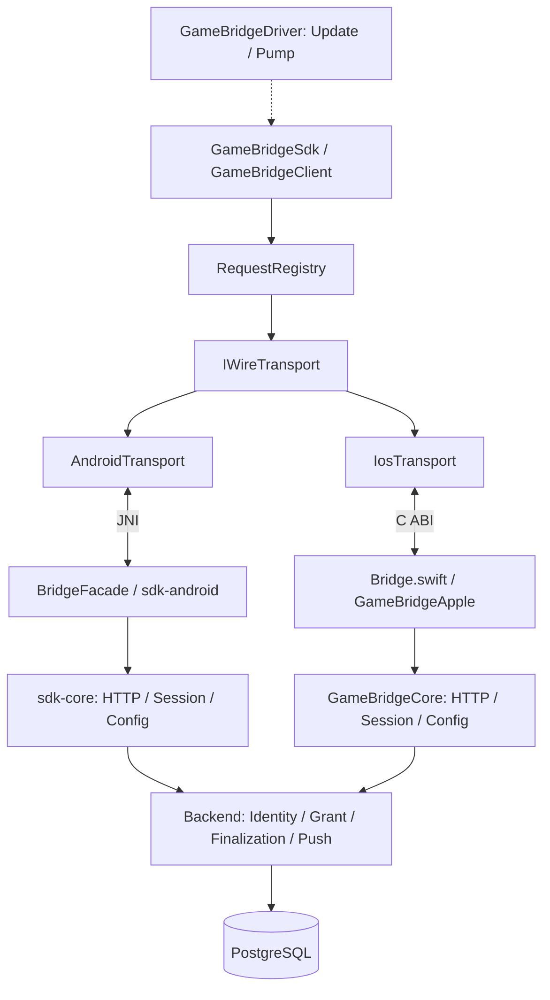
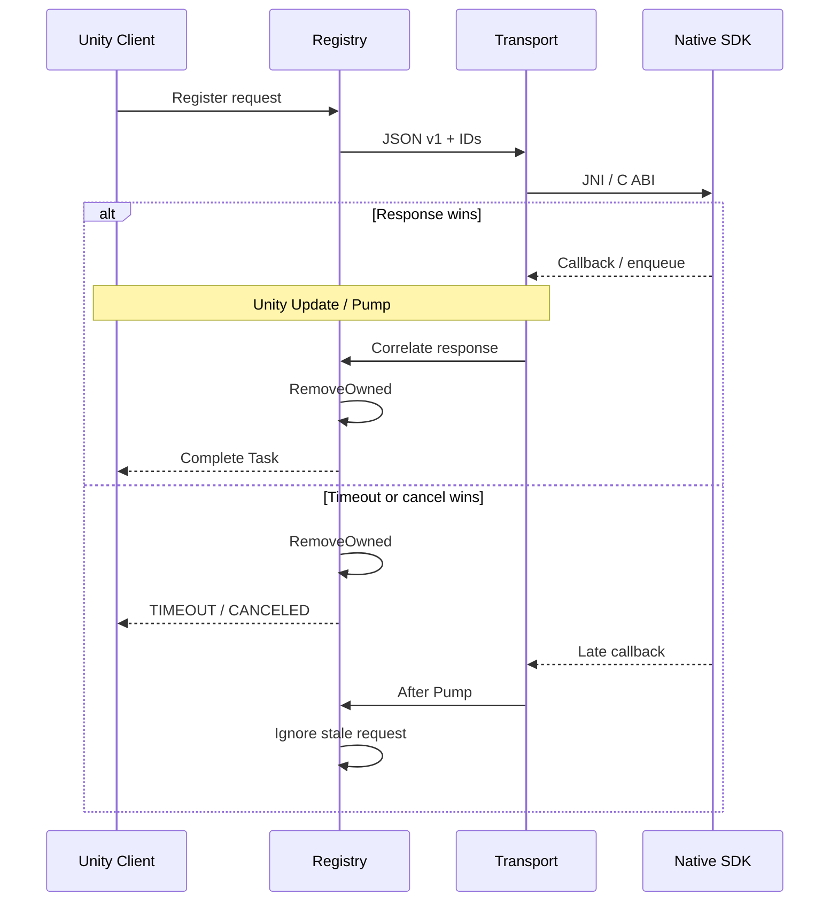
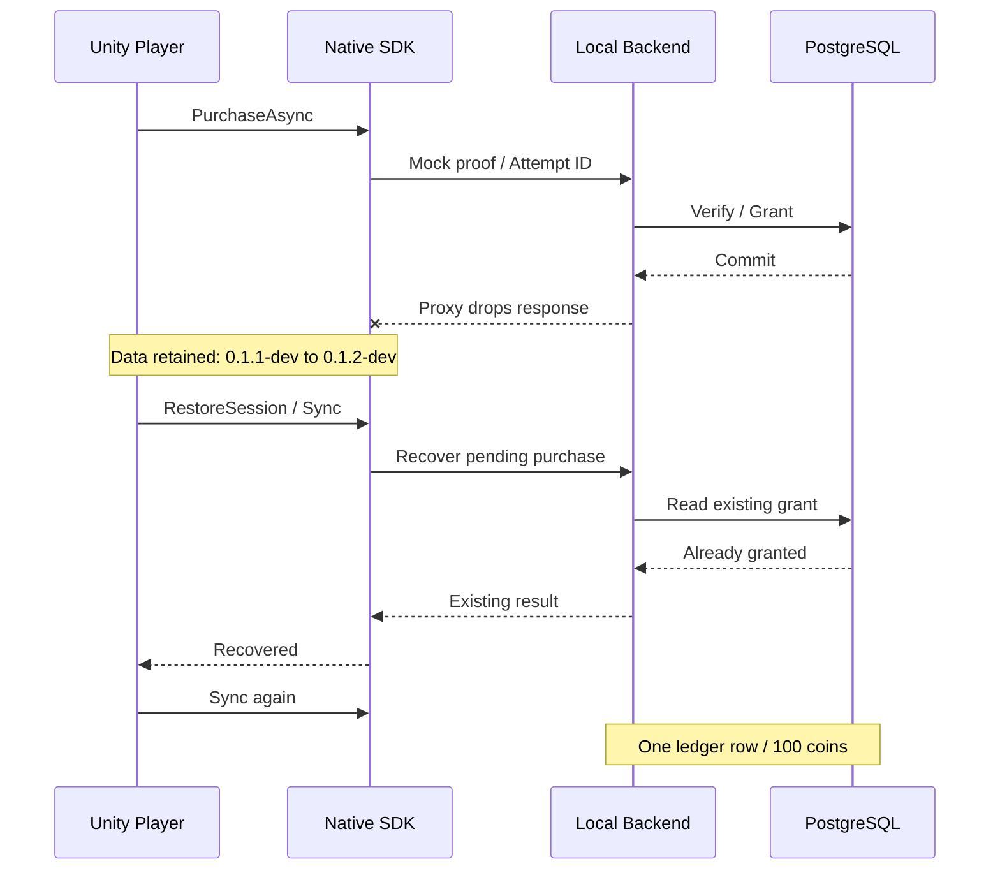
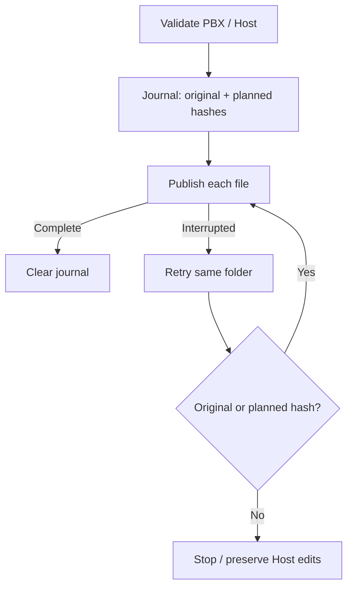
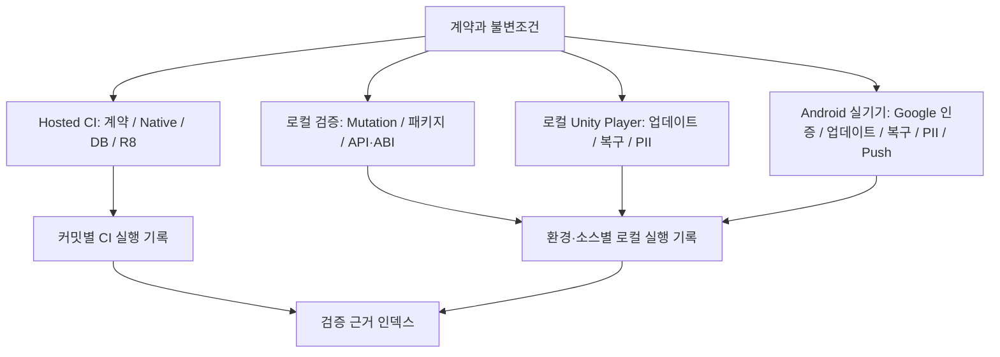

# GameBridge SDK — Technical Overview

> **Unity · Android · iOS 게임 플랫폼 SDK: 공통 API부터 구매 정합성, 비동기 수명주기, 배포 호환성까지**
>
> 개인 기술 포트폴리오 · [v0.1.2-dev Pre-release](https://github.com/CodingBot000/GameBridge_SDK/releases/tag/v0.1.2-dev) · Bridge Protocol v1  
> [구현·테스트·실행 근거](VERIFICATION_EVIDENCE.md)

[아키텍처](#2-아키텍처) · [설계 선택](#3-설계-선택과-trade-off) · [Edge Case](#4-failure-model과-불변조건) · [문제 해결](#5-대표-기술-사례) · [검증 전략](#6-검증-전략) · [배포와 호환성](#7-sdk-배포와-호환성) · [상세 기록](#8-검증-환경과-상세-기록)

## 1. Engineering Objectives

GameBridge는 Unity 게임에서 Android·iOS의 인증·결제·푸시를 동일한 C# 인터페이스로 사용하는 SDK입니다. 플랫폼 연결뿐 아니라 **응답 유실 후 구매 복구, 비동기 요청의 중복 완료 방어, Unity Export 중단 복구, SDK 업데이트 시 소비자 호환성**을 구현하고 검증했습니다.

**Android 실기기 검증(2026-11-27):** Android 12(API 31) 실기기(SM-G975N)에서 v0.1.2-dev Native·Unity Google 실계정 인증, LOCAL_MOCK 구매 복구·버전 교체·Push·개인정보 검사를 수행했습니다. [기본 검증](evidence/android-physical-local-mock-20261127.md) · [추가 검증](evidence/android-physical-followup-20261127.md).

| 핵심 과제 | 설계와 확인한 결과 | 상세 |
| --- | --- | --- |
| 지급 후 응답 유실·앱 재시작 | 서버 원장을 기준으로 복구. Android 실기기 LOCAL_MOCK 업데이트에서 지급 1건·100코인 유지 및 추가 회수 0건; AVD·iOS Simulator 결과 별도 | [구매 정합성](#51-구매-응답-유실과-중복-지급-방어) |
| 비동기 응답 경쟁·지연 callback | 요청 소유권과 SDK 세션 격리로 Task 최대 한 번 완료. 중복 응답 방어를 제거한 변이와 정상 소스를 대조 | [요청 수명주기](#53-비동기-요청-경쟁과-지연-callback) |
| Unity iOS Export 중단·Host 충돌 | journal로 같은 폴더에서 변경 재개, 외부 Host 편집 보호. 쓰기 중단 주입과 재Export·Simulator 빌드 확인 | [Export 복구](#52-unity-ios-export--중단-복구-및-host-변경-보호) |
| SDK 내부 리팩토링·배포 | 선정 API·ABI 대조와 독립 소비자 검증, Android 실기기에서 버전 교체·세션·구매 복구 및 기존 AVD·iOS Simulator 회귀 | [소비자 호환성](#55-sdk-리팩토링과-소비자-호환성) |

## 2. 아키텍처

### 2.1 Component architecture — 플랫폼과 책임 경계

Unity 관리 코드, Native Provider adapter, 서버 상태의 책임 경계를 나타냅니다. Native 앱은 플랫폼 SDK를 직접 소비할 수 있고, Unity Editor의 `EditorOfflineTransport`는 Native·Backend 없이 동작하는 메모리 Fake입니다.

| 경계 | 소유 책임 | 소스 |
| --- | --- | --- |
| Host | UI·Activity/window·권한·앱 수명·플랫폼 등록 | [Android 예제](../android/host-examples), [iOS 예제](../ios/host-examples) |
| Unity | 공통 typed API, SDK 세대, 요청 상관관계, timeout/cancel, 정제 이벤트 | [GameBridgeClient](../unity/Packages/com.gamebridge.sdk/Runtime/GameBridgeClient.cs), [RequestRegistry](../unity/Packages/com.gamebridge.sdk/Runtime/Core/RequestRegistry.cs) |
| Android | JNI callback, Provider adapter, 세션 및 Keystore 기반 저장 | [AndroidTransport](../unity/Packages/com.gamebridge.sdk/Runtime/Platforms/AndroidTransport.cs), [BridgeFacade](../android/sdk-unity-bridge/src/main/kotlin/com/gamebridge/bridge/BridgeFacade.kt) |
| iOS | C ABI/AOT callback, Swift Provider adapter, Keychain 및 HTTP | [IosTransport](../unity/Packages/com.gamebridge.sdk/Runtime/Platforms/IosTransport.cs), [Bridge.swift](../ios/UnityBridge/Bridge.swift), [GameBridgeApple](../ios/Sources/GameBridgeApple) |
| Backend | identity/proof 검증, 세션 발급·폐기, 계정 binding, 지급 및 token 소유권 | [Session](../backend/src/main/kotlin/com/gamebridge/session/Sessions.kt), [Purchase](../backend/src/main/kotlin/com/gamebridge/purchase), [DB migration](../backend/src/main/resources/db/migration) |

### 2.2 데이터 권위와 신뢰 경계

- **인증:** Provider proof와 SDK access/refresh token은 Native·Backend에서 관리하고, Unity에는 정제된 사용자·세션 결과를 전달합니다. 서버의 identity 검증과 Native 보안 저장을 분리합니다.
- **구매:** 스토어 구매 결과, 서버 지급, 스토어 완료 처리, UI의 권한 조회를 각각의 상태로 관리합니다. 지급 권위는 서버 원장에 두며 UI는 서버 entitlement를 표시합니다.
- **푸시:** Host 권한, Native token 획득, 서버 installation/session 소유권, Native route·중복 제거와 C# 정제 이벤트를 분리합니다.

세부 정책: [SECURITY](SECURITY.md) · [API](API.md) · [Bridge JSON Schema](../contracts/bridge.schema.json).

### 2.3 Async request — 플랫폼 간 수명주기

`requestId`, `sdkSessionId`, `operation`, `protocolVersion`을 대조하고 응답·timeout·cancel이 같은 pending 소유권 제거 경로를 사용합니다. iOS callback byte는 즉시 복사하고, 양 플랫폼 callback queue는 Unity Update에서 Pump합니다. 이 main-thread 이벤트 전달 경계와 Task continuation의 실행 스레드 계약은 구분합니다. **Task timeout·취소는 호출자의 대기 종료이며, 실제 스토어 거래의 취소와는 별개입니다.** 미완료 거래는 구매 복구 경로에서 처리합니다.

## 3. 설계 선택과 Trade-off

다음 비교는 현재 구현에 대한 사후 기술 분석입니다. 개발 당시 기록된 정책은 이어지는 [DECISIONS](DECISIONS.md) 항목으로 구분했습니다.

| 현재 구조 | 비교 가능한 대안 | 효과와 비용 |
| --- | --- | --- |
| 공통 C# API + Native Adapter | 게임 코드에서 플랫폼 API 직접 호출 | 호출 일관성과 책임 분리 / 공통 wire·플랫폼별 예외 관리 |
| Native 보안 저장 + 서버 세션 | Unity에서 raw token 관리 | C# 노출 범위 축소 / 플랫폼별 저장·갱신 구현 |
| 서버 지급 + DB 유일성·멱등 원장 | 클라이언트 성공 callback으로 지급 | 재시도 시 지급 정합성 방어 / 서버 의존성과 응답 유실 복구 |
| Callback Queue + Main-thread Pump | Native callback에서 즉시 Unity API 호출 | Unity 접근 스레드 제한 / 큐 지연·용량·종료 관리 |
| Journal 기반 Export 복구 | 새 폴더 재Export 또는 전체 덮어쓰기 | 같은 경로에서 변경 재개·Host 보호 / 해시·journal·충돌 처리 |
| 선정 API·ABI + 독립 소비자 검증 | 내부 빌드 성공 확인 | 실제 소비 경계의 회귀 탐지 / 비교 범위·버전 관리와 검증 비용 |
| 명시적 LOCAL_MOCK / Sandbox 분리 | 실제 Provider 실패 시 Mock fallback | 환경별 실패 원인과 결과 의미 유지 / 별도 설정·환경 준비 |

### 개발 당시 기록된 기술 결정

2026-11-10의 [정책 결정 기록](DECISIONS.md)과 구현·시험을 연결했습니다. 아래 효과와 비용은 각 정책의 기술적 해석입니다.

| 기록된 정책 | 설계 의미와 비용 | 구현·시험 |
| --- | --- | --- |
| **설정 실패 시 신규 구매만 차단** | 유효 설정 없이는 새 거래를 시작하지 않고, 기존 검증·복구·로그아웃은 허용. 설정 cache 기본 5분으로 최신성과 가용성 절충 | [MaintenanceGate](../android/sdk-core/src/main/kotlin/com/gamebridge/MaintenanceGate.kt), [cache](../android/sdk-core/src/main/kotlin/com/gamebridge/ServiceConfigurationRepository.kt), [Gate 시험](../android/sdk-core/src/test/kotlin/com/gamebridge/MaintenanceGateTest.kt) |
| **Refresh 만료를 최초 발급 기준 7일로 고정** | 회전 시 만료를 연장하지 않음. 지속 사용 편의보다 세션 수명 상한을 우선 | [발급·회전](../backend/src/main/kotlin/com/gamebridge/session/Sessions.kt), [DB 만료 시험](../backend/src/test/kotlin/com/gamebridge/session/SessionExpiryDatabaseTest.kt) |
| **기기 내 구매 증빙 검증 동시성 기본 1건** | 설정 가능한 기기 내 제한으로 동시 검증을 통제. 처리량과 대기 시간의 절충 | [Android Semaphore](../android/sdk-android/src/main/kotlin/com/gamebridge/android/purchase/GooglePlayBillingProvider.kt), [iOS limiter](../ios/Sources/GameBridgeApple/StoreKitBillingProvider.swift), [permit·취소 시험](../ios/Tests/GameBridgeCoreTests/StoreKitBillingProviderTests.swift) |
| **Push 중복 제거를 최근 messageId 200개로 제한** | SDK 세션 안에서 수신·열기를 구분하고 오래된 항목 제거. 메모리 사용을 제한하며 로그아웃·계정 변경 시 상태 초기화 | [Android Router](../android/sdk-core/src/main/kotlin/com/gamebridge/PushRouter.kt), [iOS Router](../ios/Sources/GameBridgeCore/PushRouter.swift), [bounded recency 시험](../android/sdk-core/src/test/kotlin/com/gamebridge/PushRouterTest.kt) |
| **Google 구매 증빙은 완료 확인까지 암호화 보관 후 삭제** | 완료 재시도에 필요한 증빙을 유지하고 확인 후 제거. 복구 가능성과 민감정보 보관 최소화의 균형 | [저장](../backend/src/main/kotlin/com/gamebridge/purchase/GoogleGrantService.kt), [삭제](../backend/src/main/kotlin/com/gamebridge/purchase/GoogleFinalizationWorker.kt), [격리 DB·fake finalizer 시험](../backend/src/test/kotlin/com/gamebridge/purchase/GoogleGrantDatabaseTest.kt) |

## 4. Failure Model과 불변조건

| 실패·Edge Case | 유지할 조건과 방어 | 근거 |
| --- | --- | --- |
| 중복 응답·timeout·cancel 경쟁 | pending 소유권을 원자적으로 제거, Task 최대 한 번 완료 | [Registry](../unity/Packages/com.gamebridge.sdk/Runtime/Core/RequestRegistry.cs), [Mutation](../harness/check-bridge-mutation.py) |
| 이전 세션 callback·Dispose 이후 이벤트 | 현재 SDK 세대·세션에만 전달 | [LateCallback 시험](../tests/UnityLateCallback/Program.cs) |
| 요청 폭주·비정상 JSON | pending 최대 100, wire 256KiB 제한, 형식·상관관계 검사 | [Registry](../unity/Packages/com.gamebridge.sdk/Runtime/Core/RequestRegistry.cs) |
| 같은 거래·다른 키 / 같은 키·다른 body | 거래 UNIQUE·body hash·원장 제약으로 충돌 시 추가 지급 방지 | [LOCAL_MOCK 지급](../backend/src/main/kotlin/com/gamebridge/purchase/MockPurchaseController.kt), [DB 원장 시험](../backend/src/test/kotlin/com/gamebridge/purchase/LedgerInvariantDatabaseTest.kt) |
| 지급 후 응답 유실 | 기존 거래를 조회·복구하고 지급 결과 재사용 | [실기기 업데이트 복구](evidence/android-physical-followup-20261127.md) · [AVD·iOS Simulator 기록](evidence/bridge-client-refactor-verification.md#이전-공개-버전에서-업데이트) |
| Push 중복·계정 변경·로그아웃 | route allowlist, messageId 중복 제거, session/token 소유권 | [Android Player](evidence/p10-batch32-android-push-c.json), [iOS 후속 Player](evidence/bridge-client-refactor-verification.md#2026-11-26-후속-실제-player-검증) |
| raw credential·PII 포함 callback | typed 허용 필드만 공개, 민감 원문 정제 | [양 플랫폼 합성 PII Player](evidence/bridge-client-refactor-verification.md#2026-11-26-후속-실제-player-검증) |
| Export 중단·외부 Host 편집 | original/planned hash 일치 시 복구, 외부 변경 시 중단 | [IosExportFiles](../unity/Packages/com.gamebridge.sdk/Editor/IosExportFiles.cs), [PR #11](https://github.com/CodingBot000/GameBridge_SDK/pull/11) |
| 반복 초기화·종료·Scene 교체 | pending 정리, callback·driver 연결 해제 | [수명주기 기록](evidence/p10-batch34-unity-performance.json), [후속 종료 검증](evidence/bridge-client-refactor-verification.md#2026-11-26-후속-실제-player-검증) |

## 5. 대표 기술 사례

### 5.1 구매 응답 유실과 중복 지급 방어

서버가 지급을 commit한 뒤 응답이 유실되면 클라이언트는 성공 여부를 확정할 수 없습니다. 앱 재시작이나 SDK 교체 후에도 같은 거래가 다시 제출될 수 있어, **요청의 성공 여부와 서버 지급 상태를 분리하고 서버에서 중복을 판별**했습니다.

LOCAL_MOCK 실행 경로인 [MockPurchaseController.verify](../backend/src/main/kotlin/com/gamebridge/purchase/MockPurchaseController.kt)는 테스트 proof를 사용자·상품에 결속하고 DB transaction 안에서 다음을 처리합니다.

| 처리 경계 | 방어 |
| --- | --- |
| 같은 멱등키에 다른 요청 | body hash가 다르면 충돌로 거부 |
| 같은 거래에 다른 멱등키 | 거래 hash UNIQUE와 기존 구매의 사용자·상품 대조 |
| 재요청에 따른 중복 지급 | 새 구매를 삽입한 경우에만 원장 또는 entitlement 기록 |
| 완료 처리와 재요청 | 신규 거래의 finalization job·멱등 기록 저장, 기존 거래에는 ALREADY_GRANTED 반환 |

실 Provider용 [GoogleGrantService](../backend/src/main/kotlin/com/gamebridge/purchase/GoogleGrantService.kt)에는 세션·계정 binding, attempt ID/body hash, 거래 UNIQUE, 원장·권한·완료 작업 및 암호화 증빙 저장이 구현되어 있습니다. 아래 업데이트 복구 결과의 실행 환경은 **LOCAL_MOCK**입니다.

**실기기 업데이트 복구 결과:** Android 12(API 31) 실기기(SM-G975N)에서 동일 applicationId·서명의 APK를 versionCode 1 → 102, SDK 0.1.1-dev → 0.1.2-dev로 덮어 설치했습니다. LOCAL_MOCK 서버의 첫 지급 응답 유실 후 세션과 미완료 구매 1건을 복구했습니다. 서버 구매 검증 2회, 최종 원장 1건·100코인, 두 번째 동기화 회수 0건을 확인했습니다. [실기기 추가 검증](evidence/android-physical-followup-20261127.md).

**AVD·Simulator 교차 검증:** Unity 6000.5.8f1, Android API 34 AVD와 iOS 18.6 Simulator에서 각각 앱·DB 데이터를 유지한 채 0.1.1-dev → 0.1.2-dev 덮어 설치 후 세션과 미완료 구매를 복구했습니다. 각 DB 원장은 순증 1건·100코인이었고 두 번째 동기화에서 추가로 복구된 구매는 0건이었습니다. [실행 기록](evidence/bridge-client-refactor-verification.md#이전-공개-버전에서-업데이트)과 [Android](../tests/UnityAndroidRestartConsumer/MockPlayerScenario.cs)·[iOS fixture](../tests/UnityIosRestartConsumer/MockIosPlayerScenario.cs)에 복구 건수·잔액·재동기화 assertion을 연결했습니다.

**원장 방어 검증:** 격리 schema에서 원장의 UNIQUE 제약을 제거하면 중복 INSERT를 허용하므로 기대 assertion이 실패해야 합니다. 정상 schema에서는 같은 INSERT를 거부하는지 대조했습니다.

| 격리 DB 대조 | 기록된 결과 |
| --- | --- |
| UNIQUE 유지 | Gradle exit 0, 테스트 1개, 실패 0개 |
| UNIQUE 제거 | Gradle exit 1, 테스트 1개, 예상 실패 1개, 오류·skip 0개 |

[DB 제약](../backend/src/main/resources/db/migration/V1__initial_schema.sql) · [원장 시험](../backend/src/test/kotlin/com/gamebridge/purchase/LedgerInvariantDatabaseTest.kt) · [Mutation 판정](../harness/check-ledger-mutation.py) · [격리 DB 실행 기록](evidence/p09-ledger-mutation-20261113.md) · [구현·시험·실행 근거](VERIFICATION_EVIDENCE.md#구매-데이터-정합성과-업데이트-복구).

### 5.2 Unity iOS Export — 중단 복구 및 Host 변경 보호

**증상과 원인:** Google callback source가 거부될 때 일부 SPM 소유권 파일만 먼저 남고 PBX 저장은 완료되지 않았습니다. Host를 수정하고 같은 디렉터리에서 재시도하면 소유권이 어긋났습니다.

**해결:** 파일 잠금과 PBX·callback·소유권 사전 검증을 적용하고, original/planned hash를 recovery journal에 고정해 남은 변경을 재개하도록 했습니다. publish의 원자성은 **파일 단위**입니다. 여러 파일의 중간 상태는 journal로 복구하며, 각 파일이 original 또는 planned hash와 일치할 때만 진행합니다. 외부 Host 편집이 감지되면 중단해 해당 편집을 보존합니다.

**검증:** PR #11에서 PBX·callback 검사 항목 **157개**와 쓰기 지점 **4곳**의 중단 주입을 기록했습니다. 같은 폴더 재시도, Host 편집 보존, 반복 Hook 적용 및 새 Unity Export·Simulator 빌드를 확인했습니다.

[PR #11 — 증상·수정·결과](https://github.com/CodingBot000/GameBridge_SDK/pull/11) · [Journal·해시 복구](../unity/Packages/com.gamebridge.sdk/Editor/IosExportFiles.cs) · [Export Hook](../unity/Packages/com.gamebridge.sdk/Editor/IosXcodeBuildHook.cs) · [중단 주입·Host 보존 assertion](../tests/UnityIosHook/Program.cs).

### 5.3 비동기 요청 경쟁과 지연 callback

플랫폼 callback과 timeout·cancel·shutdown은 같은 요청의 완료 권한을 두고 경쟁합니다. SDK 재생성 뒤에는 이전 세션의 callback도 도착할 수 있습니다. 이를 **요청 상관관계, 완료 소유권, 세션 격리, Unity 접근 스레드**의 네 경계로 나눴습니다.

pending 등록과 소유자 제거를 lock으로 보호합니다. 응답·timeout·cancel은 같은 완료 경로를 사용하며, Dispose 시 대기 요청을 정리합니다. 응답의 요청·세션·operation을 대조하며, iOS callback byte의 즉시 복사와 queue 제한으로 전달 수명도 관리합니다. timeout 이후 동일 응답 반복, stale session event, Dispose 이후 event를 [관리 코드 시험](../tests/UnityLateCallback/Program.cs)에서 확인했습니다.

[Bridge Mutation 하네스](../harness/check-bridge-mutation.py)는 별도 복사본의 중복 응답 guard를 제거해 `RequestRegistry.HandleMessage`의 예상 예외 경로를 탐지합니다. 정상 중복 응답 probe와 원본 해시 보존도 대조합니다. [Mutation 기록](evidence/p09-bridge-mutation-20261111.md).

[RequestRegistry 구현](../unity/Packages/com.gamebridge.sdk/Runtime/Core/RequestRegistry.cs) · [기존 회귀 기록](evidence/p10-batch34-regression.json) · [리팩토링 후 회귀·Player 검증](evidence/bridge-client-refactor-verification.md).

### 5.4 iOS Native 의존성과 OAuth callback 장애 분석

| 장애 | 원인 분석과 수정 | 확인 결과 |
| --- | --- | --- |
| UnityFramework dlopen / FBAEMKit lookup 실패 | runpath·서명을 확인한 뒤, 강한 동적 의존성 4개가 Host 앱에 빠진 것을 식별. SPM 제품을 Host target에 연결하고 강한 링크 유지 | 이전 실패 앱 거부, 새 앱의 Framework 4개 존재·서명과 LOCAL_MOCK Player 통과. [Meta 분석](IOS_META_EMBED_FIX.md) |
| 합성 Google URL의 Native callback 누락 | Native ABI 0건·Unity URL event 1건에서 stock UnityScene의 별도 URL 경로 식별. AppController·Scene opt-in forwarding과 충돌 감지 적용 | 합성 warm URL에서 Native ABI 1회·Unity event 0건, 당시 PBX/URL 검사 71개 및 새 Export 빌드 통과. [OAuth 분석](IOS_GOOGLE_OAUTH_VERIFICATION.md) |

PR #11의 별도 회귀에는 합성 cold/warm URL과 정상 Host URL 시험도 포함됩니다. [PR #8](https://github.com/CodingBot000/GameBridge_SDK/pull/8) · [PR #11](https://github.com/CodingBot000/GameBridge_SDK/pull/11).

**최신 Android 실기기 인증:** 2026-11-27 KST, Android 12(API 31) 실기기(SM-G975N)에서 v0.1.2-dev Native·Unity와 HTTPS PLATFORM_SANDBOX의 Google 실계정 로그인·UI 취소·프로세스 재시작 후 기존 세션 복원·로그아웃 후 복원 차단을 확인했습니다. 복원 중 신규 challenge/세션 발급 없이 동일 세션을 사용했고, 완료 실행에서 서버 세션은 폐기되어 활성 0개였습니다. [실기기 실행 기록](evidence/android-physical-followup-20261127.md).

**이전 버전의 Google 실계정 인증 기록:** Android는 **2026-11-25 KST**, 0.1.1-dev Native/Unity 앱과 API 34 AVD에서 로그인·UI 취소·취소 후 재로그인·재실행 후 SDK 세션 복원·로그아웃을 확인했습니다. 로그아웃 시 해당 시험 세션만 폐기됐습니다. iOS는 **2026-11-23 KST**의 Native/Unity iOS 18.6 Simulator 앱에서 로그인·UI 취소·재실행 후 SDK 세션 복원·로그아웃을 확인했습니다. 세션 복원, SDK token refresh/replay 및 합성 URL forwarding의 실행 범위는 각 기록에 구분되어 있습니다.

[이전 Android AVD 실계정 결과](evidence/android-google-live-20261125.md) · [iOS 실계정 결과](IOS_GOOGLE_OAUTH_VERIFICATION.md#session-lifecycle-and-automatic-callback-2026-11-23-kst).

### 5.5 SDK 리팩토링과 소비자 호환성

Android의 Google·Apple/Facebook adapter에서 Store 수명주기와 FCM token 획득을 공통화하고, 각 Provider의 오류·세션·HTTP 호출 경계는 유지했습니다. Unity는 같은 assembly 안에서 상태 모델과 diagnostics/capability decoder를 분리하고, 초기화·종료·이벤트 수명주기는 기존 Facade에 남겼습니다.

변경 전후 **선정 API·ABI**를 비교하고 R8·Swift·Unity 독립 소비자, 누락 패키지·slice 음성 시험, 양 플랫폼의 버전 교체 후 세션·미완료 구매 복구로 소비자 영향을 확인했습니다. 대상과 측정 단위는 [배포·호환성](#7-sdk-배포와-호환성)에 정리했습니다.

[PR #18](https://github.com/CodingBot000/GameBridge_SDK/pull/18) · [변경·검증 상세](evidence/bridge-client-refactor-verification.md) · [전이 계약](../contracts/bridge-client-refactor-transition.json).

추가 문제 해결 기록: [Unity 빌드와 runtime ADB 수명 충돌](ENGINEERING_NOTES.md#문제-해결-1--unity-빌드와-runtime-adb-수명-충돌), [OS별 파일 열거 순서에 따른 OpenAPI CI 실패](ENGINEERING_NOTES.md#문제-해결-2--os별-파일-열거-순서에-따른-openapi-ci-실패).

## 6. 검증 전략

계약과 불변조건을 기준으로 Hosted CI·로컬 검증·Unity Player 결과를 각각의 실행 환경과 소스 기준에 따른 기록으로 연결했습니다.

검증은 [계약·음성 검사](../harness), [격리 DB·HTTP 회귀](evidence/p10-batch34-regression.json), [Fault Injection·독립 소비자·Player 시험](evidence/bridge-client-refactor-verification.md)을 결합합니다. Mutation은 앞선 사례처럼 방어 제거 시의 예상 실패와 정상 대조를 함께 확인합니다.

### AI 개발 과정의 품질 통제

[AGENTS.md](../AGENTS.md)에 API·wire 계약, 구현과 실행 상태의 구분, 실패 기록 보존과 작업 경계를 명시했습니다. 리팩토링은 [전이 계약](../contracts/bridge-client-refactor-transition.json)과 [전이 검사](../harness/check-bridge-client-refactor-transition.py)로 승인된 경로·변경 전후 해시·공개 선언을 대조하고 기존 기준의 guard도 확인합니다. 여기에 결함을 주입하는 Mutation과 독립 소비자 실행을 연결해, 문서상의 규칙을 코드와 실행 결과로 확인할 수 있게 구성했습니다.

### 공개 CI와 로컬 증거의 차이

| 실행 경로 | 기록된 범위 | 근거 |
| --- | --- | --- |
| Hosted CI | inventory-contracts, backend-postgres, android-native, swift-ios-simulator, basic-ci. PR #24 기본 5개 검사 성공 | [해당 실행](https://github.com/CodingBot000/GameBridge_SDK/actions/runs/45980838197), [CI 구성·실행 이력](CI.md) |
| Android 실기기 | Android 12(API 31) 실기기(SM-G975N), v0.1.2-dev Native·Unity: Google 실계정(HTTPS PLATFORM_SANDBOX), LOCAL_MOCK 버전 교체·구매 복구·합성 PII·Push·종료 | [기본 검증](evidence/android-physical-local-mock-20261127.md) · [추가 검증](evidence/android-physical-followup-20261127.md) |
| AVD·Simulator 로컬 검증 | Unity 6000.5.8f1, Android API 34 AVD·iOS 18.6 Simulator에서 0.1.2-dev LOCAL_MOCK 업데이트·복구 및 후속 PII·종료 시험 | [환경·소스·결과 기록](evidence/bridge-client-refactor-verification.md) |

[공개 검증 근거](VERIFICATION_EVIDENCE.md)는 각 주장에 구현·시험 소스와 실제 실행 기록을 연결합니다. 공개 요약과 로컬 원본의 제공 범위도 이 인덱스에서 확인할 수 있습니다.

## 7. SDK 배포와 호환성

| 확인 항목 | 0.1.2-dev 검증 범위 |
| --- | --- |
| C# 공개 reflection | 기준·후보의 공개 메타데이터 출력 **383줄** 비교·일치 |
| JVM / JNI | 선정 JVM 클래스 5개의 공개 descriptor와 BridgeFacade/BridgeCallback JNI 대조 |
| iOS C ABI | GB 심볼 5개와 header, device arm64·Simulator arm64/x86_64 slice의 바이너리 비교 |
| 배포·소비 | UPM TGZ·Maven ZIP·static XCFramework ZIP, 독립 R8·Swift 소비·Unity import 및 체크섬 |
| SDK 업데이트 | Android 실기기 및 이전 Android API 34 AVD·iOS 18.6 Simulator에서 0.1.1-dev → 0.1.2-dev LOCAL_MOCK 덮어 설치·데이터 복구 |
| 후속 Player | Android 실기기 합성 PII·LOCAL_MOCK Push·세션 전이·Google 실계정, 기존 양 플랫폼 합성 PII와 로그아웃 후 복원 차단·종료 및 iOS LOCAL_MOCK Push |

[공개 Pre-release](https://github.com/CodingBot000/GameBridge_SDK/releases/tag/v0.1.2-dev)는 패키지 3종과 `RELEASE_NOTES.md`, `SHA256SUMS`, `SOURCE_MANIFEST.json`으로 구성됩니다. 패키지별 SHA-256과 검증 후보의 대응은 [공개 배포 근거](VERIFICATION_EVIDENCE.md#sdk-배포와-선정-apiabi-검증)에 연결했습니다. 바이너리 대조와 OS·기기 실행 환경은 [COMPATIBILITY](COMPATIBILITY.md)에 구분했습니다.

[설치·통합](INTEGRATION.md) · [호환성 기준](COMPATIBILITY.md) · [변경 이력](CHANGELOG.md).

## 8. 검증 환경과 상세 기록

구현·시험 소스 기준은 [main `d37e8a1`](https://github.com/CodingBot000/GameBridge_SDK/commit/d37e8a105d3f47d25a24ccb2e44c7ef97f1cc3b4)입니다. Android 실기기 시험은 v0.1.2-dev 배포 기준과 [실기기 추가 검증](evidence/android-physical-followup-20261127.md)의 환경·fixture를 따릅니다. 기능·버전·실행별 상세 기록은 다음 문서에 정리했습니다.

| 확인 목적 | 문서 |
| --- | --- |
| 기능별 구현·실행 상태와 Provider 범위 | [FEATURE_MATRIX](FEATURE_MATRIX.md) |
| 버전·엔진·OS·기기별 검증 환경 | [COMPATIBILITY](COMPATIBILITY.md) |
| 주장별 구현·시험·실행 및 원본 접근 범위 | [VERIFICATION_EVIDENCE](VERIFICATION_EVIDENCE.md) |
| 장애 원인 분석과 후속 조사 | [ENGINEERING_NOTES](ENGINEERING_NOTES.md#알려진-제한과-선택적-후속-작업) |
| CI 실행 이력과 프로젝트 상태 | [CI](CI.md), [FINAL_REPORT](FINAL_REPORT.md) |
